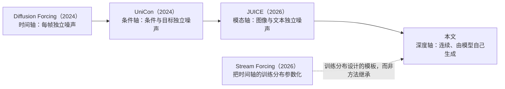
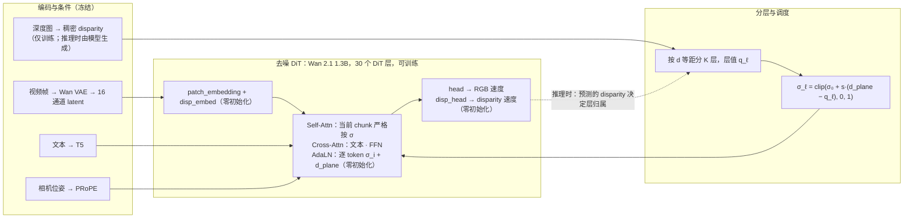
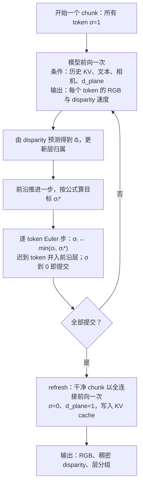

# WaveFront：先近后远去噪的世界模型

研究提案 v3 · 2026 年 10 月 27 日

> 标 **【待定·数据】** 的地方要先看 SpatialVID 的实际数据才能定，汇总在 6.4。相对 v2 的改动见附 B。

## 1. 概述

Diffusion 的调度一直是一维的：只有噪声水平 σ。我们在自回归视频 diffusion 的每个 chunk 内部加上第二个轴——深度——让每个 token 的噪声水平成为 (σ, 深度) 的函数。具体做法是把 chunk 内的 token 按 disparity 等距分成 K 层，用斜率 s 控制层与层之间的噪声错位：s=0 是标准 diffusion，s≥K 是严格的"先近后远"逐层自回归，二者之间是一个连续的滚动调度族。3D 一致性和分层深度表示由此成为调度的副产物，不需要渲染器、3D 教师特征或外部记忆。

对模型的改动：噪声水平从逐帧改为逐 token；新增一个标量条件 d_plane（当前扫描到哪个深度）；新增一个 disparity 输入/输出通道；当前 chunk 内的 attention 严格按噪声水平排序（噪声低的不看噪声高的）。新增参数全部零初始化，初始化时 s=0 的前向与原模型数值一致。一次训练覆盖整个调度族。

实验分两层。主结果是公平对比：所有方法从同一个 minWM 权重出发，用同一份数据、同样的训练预算各训一次，再在 benchmark 上比较（7.2）。消融是一张"路径表"：同一组权重，只换采样器走不同的调度路径，拆开顺序、方向、层数和 attention 各自的作用（7.3）。

## 2. 背景与动机

AR 视频 diffusion（CausVid、Self-Forcing、Causal Forcing 及各类交互式世界模型）逐 chunk 生成，chunk 间 causal attention 加 KV cache，是实时世界模型的主流架构。它的核心弱点是没有 3D：相机转一圈回来场景变了，遮挡边界糊，长程不一致。其中长程重访的不一致主要是记忆问题：相机离开太久，之前的画面已经不在 KV cache 里，这属于第 11 节所说的正交方向。本文针对的是生成过程本身的几何，也就是视差、遮挡边界，以及相邻一段时间内画面之间的跨视角一致性。

给视频 diffusion 补 3D 的方法有四类：联合输出几何通道或对齐几何特征（Aether、DeepVerse、Geometry Forcing）；3D 记忆检索（WorldMem、VMem、LSM-World、WorldKV）；3D 结构噪声（EquiVDM、UniCaMo、CameraNoise）；相机位置编码（PRoPE、SCoPE）。它们都在 backbone 外面挂东西，四个口子都已拥挤。它们从未动过的对象是**生成顺序本身**。本提案改的就是这个。

## 3. 核心想法

### 3.1 直觉

普通 diffusion 里"哪些地方先变清晰"是随机均匀的。我们让它由深度决定，像雾从近到远散开：第一轮只把离相机最近的一层去噪到底，其余仍是噪声；第二轮以近层为条件生成稍远一层；最后一轮是远景。

```
深度      近 ──────────────────────────────▶ 远
          第 0 层      第 1 层      第 2 层
第 1 轮   ████████     ░░░░░░░░     ░░░░░░░░
第 2 轮   ████████     ████████     ░░░░░░░░
第 3 轮   ████████     ████████     ████████

████ 已去噪到底，作为条件固定      ░░░░ 仍是噪声，等下一轮
```

### 3.2 为什么按 disparity 分层

Disparity = 1/深度。相机移动时一个物体在画面里的位移正比于 disparity（近树飞退、远山不动）。按 disparity 等距分层，意味着"同一层的东西在相机运动下位移量相近"，层编号本身有几何含义；跨帧条件时层与层能对上。

深度来自视频深度模型的伪标签，尺度任意，需要统一缩放来保证层编号在时间上稳定。只缩放、不平移：平移会让无穷远不再是 0，位移也不再正比于 disparity，上面的理由就不成立了。为了与推理时可用的信息一致，缩放系数只由第一个 chunk 决定（6.2）。

代价：户外画面大部分 token 的 disparity 接近 0，等距分层下层的大小可能很不均匀（远层很大、近层很小）。严重程度要看数据统计（6.3）**【待定·数据】**。缓解办法依次是：先把 disparity 开平方根再等距分层（4.2），仍不均衡再改按分位数分层（6.3）。

### 3.3 调度平面

把调度画在"去噪进度 × 深度层"的平面上，不同斜率是这个平面上的不同路径。下面以 K=3 层、每层 T=4 步为例，数字是每次模型调用之后该层所处的噪声档位（4 = 纯噪声，0 = 干净）：

```
s = 0：标准 diffusion，所有层同步，T 次调用
调用      1  2  3  4
第0层     3  2  1  0
第1层     3  2  1  0
第2层     3  2  1  0

0 < s < K：滚动扫描，相邻层错开（此例错开一档），T + (K-1) 次调用
调用      1  2  3  4  5  6
第0层     3  2  1  0  0  0
第1层     4  3  2  1  0  0
第2层     4  4  3  2  1  0

s >= K：严格逐层（深度自回归），K x T 次调用
调用      1  2  3  4  5  6  7  8  9 10 11 12
第0层     3  2  1  0  0  0  0  0  0  0  0  0
第1层     4  4  4  4  3  2  1  0  0  0  0  0
第2层     4  4  4  4  4  4  4  4  3  2  1  0
```

把斜率取负号就是远→近，表格上下翻转即可。

与已有"多轴噪声"工作的关系：



Diffusion Forcing 在时间轴上给每帧独立噪声；UniCon 用 timestep 解耦训练让成对输入各自带独立噪声调度，同一模型可以联合生成、条件生成，甚至用带噪条件做粗控制；JUICE 给图像流和文本流各自的噪声水平，把"谁是条件、谁先生成"交给采样器；Stream Forcing 把视频采样重写成按帧索引的噪声水平随机过程，在参数化空间里构造从"各帧独立"到"按时间递进"的连续训练轨迹。我们的轴与它们有一个本质区别：**深度是连续的、内生的**——每个 token 落在哪一层由模型自己生成的 disparity 决定，而模态、条件、帧索引都是外生的离散边界。调度按 K 层量化，K 在训练时随机、推理时可任选。代价是内容依赖的归属问题（4.4）。

## 4. 方法

### 4.1 基座与不动的部分

基座是 minWM 的 Wan 2.1 1.3B chunk-causal AR 模型。minWM 把训练分成四个 Stage：Stage 0 双向 SFT，Stage 1 用 teacher forcing 训练 causal AR 模型，Stage 2 做 ODE 或一致性蒸馏，Stage 3 做 DMD。我们从 Stage 1 的权重（带 PRoPE 相机条件）续训。teacher forcing 训练时，把整段视频的干净版本和带噪版本拼成一条序列：每个带噪 chunk 只能看到它之前的干净 chunk 和它自己，相当于用真值历史当上下文。

时间轴原样保留：一个 chunk 是 4 个 latent 帧，chunk 间 causal；每个 chunk 生成完后，再用干净结果前向一次，把它的 KV 写入 cache 供后续 chunk 使用（下称 refresh）。模型只看最近 20 个 latent 帧（含当前 chunk），下称注意力窗口（minWM 配置里的 `local_attn_size=20`），约 77 个像素帧；更早的帧随 KV cache 滚动被丢掉。这些都不变——时间 causal 是 cache、蒸馏、流式的根基，真正缺的是 chunk 内的空间结构。位置编码不动（3D RoPE + PRoPE），顺序只由噪声水平和 attention mask 表达。

Token 网格：480×832 的视频经 VAE（空间 8×、时间 4×）再 patch 2×2，每个 latent 帧是 30×52 = 1560 个 token，每个 token 覆盖 16×16 像素；一个 chunk 有 6240 个 token。

### 4.2 分层与调度公式

**分层。** 每个 token 有一个 d ∈ [0,1]（1 最近，0 无穷远）：归一化到 [0,1] 的 disparity（6.2），取 token 覆盖的稠密 disparity 的高分位数（4.3）。chunk 内按 d^γ 等距分成 K 层，第 ℓ 层（ℓ=0 最近）覆盖 d^γ ∈ (1−(ℓ+1)/K, 1−ℓ/K]（最后一层包含 0），层值取上沿 q_ℓ = 1 − ℓ/K。例如 K=4 时层值依次为 1、0.75、0.5、0.25。

**幂次 γ** 决定层在远近之间怎么分。γ=1 时 d 就是归一化 disparity，层的几何含义最直接（3.2）；γ=0.5 即开平方根，把接近 0 的远处拉开。以 K=4 为例，各层下沿换算回归一化 disparity：

| 第 ℓ 层 | 0 | 1 | 2 | 3 |
|---|---|---|---|---|
| γ=1 | 0.75 | 0.5 | 0.25 | 0 |
| γ=0.5 | 0.56 | 0.25 | 0.06 | 0 |

γ=0.5 时最远一层只收比 d=1 处远 16 倍以上的内容（γ=1 时是 4 倍），近层和中层相应变大。代价是每层覆盖的 disparity 范围不再相等，"同一层位移相近"变弱，但层的先后仍按 disparity 单调。γ 是固定映射，不依赖每个 chunk 的统计量，推理时按模型预测的 d 分层也不需要额外估计。默认 γ=1，按 6.3 的层统计再定。d 始终指归一化 disparity 本身，disparity 通道的输入输出和 loss 都用它；γ 只用于分层，层归属、层值 q_ℓ 和 d_plane 都在 d^γ 上定义。这样调 γ 不改变网络学的东西，也不影响基线 ②。γ=1 时两者相同。

**调度。** 同一层的 token 共用一个噪声水平：

$$\sigma_\ell=\operatorname{clip}\big(\sigma_0+s\,(d_{\text{plane}}-q_\ell),\;0,\;1\big)$$

每个 token 的 σ_i 就是它所在层的 σ_ℓ。噪声降到 0 的 token 称为**已提交**：此后它固定不变，作为其余 token 去噪的条件。式中 **d_plane 是前沿层的层值，σ_0 是前沿层当前的噪声**；前沿层指按扫描方向最先、尚未提交、且非空的那一层。s=0 时约定 d_plane=1。σ 经调度器换算成 Wan 的 timestep 送进 AdaLN。

为什么用层值 q_ℓ 而不是连续的 d_i：若把连续 d_i 代入，s→∞ 时每个 token 只能是 0 或 1，没有任何 token 经历中间噪声，"每层去噪 T 步"无从谈起。量化之后，只要 s ≥ K，相邻层的噪声至少差 1：前沿层取 σ_0，更近的截成 0，更远的截成 1——这就是严格逐层。因此**"斜率 ∞"定义为 s=K**，更大的 s 只会在层之间插入空转步，二者等价。

| 斜率 | 行为 | 每 chunk 模型调用数 |
|---|---|---|
| s = 0 | 所有层同步，标准 diffusion | T |
| 0 < s < K | 滚动：相邻层错开 s/K 的噪声 | T·(1 + s(K−1)/K) |
| s = K（"∞"） | 严格逐层：前沿层走完一轮再换下一层，更远的层保持纯噪声；空层跳过 | K·T（K 取非空层数） |

**参数化。** 公式里 σ_0 和 d_plane 只以 c = σ_0 + s·d_plane 的组合出现，一条推理路径就是 c 从 1+s 单调降到 s/K（s>0）。d_plane 和 σ_0 都由当前状态唯一确定，训练和推理喂给模型的条件是同一个状态函数。

**方向。** 远→近是斜率取负号，前沿层改为最远的未提交层；同一组权重，换采样器即可。近→远（ray marching）让未生成位置带 free-space 陈述、有 anytime 性质、与粗→细同向；远→近（画家算法）的优势是背景先定。这是真实分叉，必须消融。

### 4.3 disparity 通道

每个 token 在 RGB latent 旁带一块稠密 disparity，与颜色联合去噪，用同一个 σ_i。稠密 disparity 在 2 像素网格上（480×832 下为 240×416），每个 token 覆盖 8×8 = 64 个值，与它的 RGB 数值个数相同。

- **来源**：伪深度降到 2 像素网格，每 2×2 像素取高分位数，不走 VAE；见 6.2。
- **输入**：每个 latent 格内的 4×4 个值经 pixel unshuffle 搬到通道维，成为 16 个通道，与 RGB latent 同为 60×104。新增 `disp_embed: Conv3d(16→1536, 1×2×2)`，与 RGB 的 patch embedding 同形，输出加到 patch embedding 的输出上。数学上就是对 2 像素网格上的 8×8 patch 做一次线性 patch embedding。
- **输出**：在输出头里，用同一份归一化加调制后的特征接 `disp_head: Linear(1536→64)`，预测这 64 个值的速度，再 pixel shuffle 回 2 像素网格。
- **每个 token 的 d**：分层（4.2）要的是一个标量，取 token 的 64 个 disparity 的高分位数（初值 90%，取实际存在的样本值，不插值），偏向近处。训练时用真值，推理时用预测值 d̂_i。这一步是确定的读出，不由网络学。
- **初始化**：两者零初始化。在数学上等价于给 patch embedding 加 16 个输入通道、给输出头加 64 行，但不改变原有权重的形状。
- **尺度**：送进网络的是 d̃ = a·(2d − 1)。d 由 6.2 的因果归一化保证落在 [0,1]，先固定映射到 [−1,1]，再乘缩放 a。不用数据集统计量，换数据集不必重算；分层仍然用 [0,1] 的 d。
  - a 决定深度比颜色早多少成形。加噪是 x_σ = (1−σ)·x + σ·ε，信号放大 a 倍等价于这个通道的噪声变轻：以 [−1,1] 为基准，token 处在 σ 时，深度通道相当于处在 σ_eff，满足 (1−σ_eff)/σ_eff = a·(1−σ)/σ。例如 a=2、σ=0.5 时 σ_eff≈0.33。深度越早稳定，按深度分层的提交越可靠，可用的斜率范围越宽。
  - 用缩放而不是给深度单独一个 timestep：二者等价，但缩放保持"每个 token 一个 σ"，mask、提交规则和 d_plane 都依赖这一点。
  - a 不设为可学习：噪声在缩放之后加，loss 量级又随 a 变化，学出来的 a 会朝 loss 小的方向退化，而不是朝生成好的方向。
  - **a = 1 / std(2d−1)，让 disparity 通道和 RGB latent 每个元素的幅度相当；估计约为 2。** std 在训练子集的真实稠密 disparity 上统计，取整后写进 config。稠密 disparity 与 RGB 每 token 都是 64 个值，所以按元素比幅度就够，不用再按每 token 的值个数修正。
    - Wan VAE 的 latent 按 Wan 自带的逐通道均值和标准差归一化，每个通道的标准差约为 1。这组统计量是 Wan 固定的，与我们的数据无关。
    - 一个通道在 σ 处的信噪比正比于它的幅度乘 (1−σ)/σ，幅度越大，越早从噪声里显出来。
    - 2d−1 在一个 chunk 内的起伏小于 1：即使 d 在 [0,1] 上均匀分布，标准差也只有 0.58，真实场景的深度更集中。a=1 时深度通道的幅度大约只有 RGB 的一半，深度会比颜色晚成形，与我们要的相反。
    - 按上式取 a 使两者幅度相当。深度图又比 RGB 纹理平滑得多，而 diffusion 在高噪声下先定低频结构，所以深度预计略早于颜色成形。
    - a=4 太大：σ=0.5 时深度通道相当于处在 σ_eff=0.2，在几乎没有颜色信息时就被定死，只能靠先验去猜；disparity 的 loss 也按 a² 放大到 16 倍。
  - **先看曲线，再决定扫不扫 a。** "低频先成形"是经验规律而不是证明，所以按 std 算出的 a 只是有理由的初值。γ 只用于分层，不影响 a。训练时按 σ 分档记录 disparity 与 RGB 各自的预测误差（7.4），不需要额外训练：
    - 深度明显晚于颜色成形，就用几百个训练步的短 run 试 2a；
    - 深度早得多，而且提交时层归属错得多，就试 a/2；
    - 曲线正常就不扫。定下后写进 config 固定。
  - **② 和 ③ 用同一个 a。** ③ 的 s=0 路径要和 ② 比，③ 调试时也从 ② 续训；a 不同，disparity 的输入分布就不同。所以 a 按 ③ 的需要一次定下。
- **loss 权重**：每个 token 有 64 个 RGB 数值、64 个 disparity 数值。两项各按元素取均值，再用显式权重 λ 平衡，初值 λ=1 时两者每 token 的权重相当。a 会改变这一项的量级，所以先定 a 再调 λ。

### 4.4 token 归属与提交

训练时层归属由伪深度给出；推理时由模型当前预测的 disparity d̂_i 决定，每一步更新。推理时每一步：

1. 前沿推进一步（c 减 1/T），按 d̂_i 和 4.2 的公式算出每个 token 的目标噪声 σ_i\*。
2. **噪声只降不升**：σ_i ← min(σ_i, σ_i\*)。估计被改远的 token 暂停，等前沿追上来，不重新加噪。
3. **迟到 token 并入前沿层**：未提交 token 的噪声不低于前沿层。估计被改近的 token 跟着前沿层一起完成，而不是一步从高噪声直接提交（那相当于从噪声直接预测干净结果，质量差）。
4. σ 到 0 的 token 提交，之后以 σ=0 和固定值参与计算；最后一步强制全部提交。

训练用真值划层、推理用预测划层，这个 exposure bias 与 LLM 完全同构。可选的兜底：训练后期把分层依据换成模型自己预测的 disparity（由一次无梯度前向得到），噪声仍按真值加。是否做视算力而定（8.3）。

### 4.5 条件 d_plane

d_plane 告诉模型"前沿在哪一层"：比它更近的内容已经固定，要生成的一切都在这个平面上或之后。σ 图只告诉模型每个 token 处在什么噪声，不告诉它当前层有多远——前景为空时，第 1 轮和第 3 轮的 σ 图完全一样。斜率不单独喂，逐 token 噪声水平已经隐含了它。

**接法。** d_plane 和 timestep 走同一条路径，但有自己的嵌入：
- **尺度**：先乘 1000，再做 sinusoidal 编码，与 timestep 同尺度（timestep = σ × 1000）。Wan 的 sinusoidal 编码频率从 1 到 10⁻⁴，是按 [0, 1000] 的输入设计的；直接输入 [0,1] 的 d_plane，只有最高的几个频率会变，其余维度几乎是常数。
- **位置**：编码后经零初始化的 Linear(256→1536)，加在 `time_embedding` 的输出上、`time_projection` 之前。这个向量一路经 `time_projection` 变成 30 个 DiT 层的 AdaLN 调制量，一路直接进输出头的调制，所以两边都能看到 d_plane；加在 `time_projection` 之后，输出头就看不到它。
- **粒度**：每个 chunk 一个 d_plane，广播到这个 chunk 的所有 token，加到它们各自 σ_i 的嵌入上。

**干净 token 取 d_plane=1。** teacher forcing 里干净的那一半和推理时的 refresh（4.1）都是整个 chunk σ=0，没有前沿。两处统一取 d_plane=1：
- 两处必须一致：干净的那一半就是训练里对 refresh 的模拟，条件不同，cache 里的 KV 就和训练时对不上。
- 取固定值，不取生成路径结束时的 d_plane。后者随路径而变（近→远结束在最远层，远→近结束在最近层），写进 cache 的 KV 就会随采样器变，之后所有 chunk 的条件也跟着变；4.6 要求历史 KV 与路径无关，就是为了避免这一点。
- 取 1 是沿用 s=0 的约定（4.2），refresh 就是 s=0 路径的终点。本方法走 s=0 时，从生成到 refresh 全程 d_plane=1，d_plane 嵌入只是一个常数偏置；这和只用 s=0 训练的联合深度基线（7.2）用法一致，两者可以直接比。

### 4.6 Attention

**当前 chunk：严格按 σ。** query token i 能看 key token j，当且仅当 σ_j ≤ σ_i（噪声更低的不看噪声更高的）。同层的 token 互相可见；已提交（σ=0）的 token 之间互相可见；s=0 时所有 token σ 相同，退化为 chunk 内全连接，也就是原模型。mask 只由当前 σ 图决定，训练和推理用同一个函数生成。

**历史 chunk：不分层。** chunk 生成完后照原样做一次 refresh：把干净的整个 chunk 以 chunk 内全连接、σ=0、d_plane=1（4.5）过一遍网络，把 KV 写进 cache。理由：

- 若历史 KV 在提交时按层写入，它的内容就取决于生成它时走的路径。换采样器会同时改变之后所有 chunk 的条件，"权重不变、只有路径在变"的论证就不干净了。
- teacher forcing 里干净的那一半与 Stage 1 训练时完全一样，没有分布漂移。
- 代价是每个 chunk 一次 refresh 前向，原模型本来就要做。
- 3.2 所说的层的几何含义照样传得过去：历史 token 带着干净的 disparity 通道。

下图是严格逐层第 2 轮时的 mask。c1、c2 是历史 chunk，c3 是当前 chunk；N/M/F 分别是近、中、远层。c3 中 N 已提交（σ=0），M 正在去噪（σ=σ_0），F 仍是纯噪声（σ=1）。

```
               c1         c2         c3
key ->       N  M  F    N  M  F    N  M  F
c1 N         #  #  #    .  .  .    .  .  .
c1 M         #  #  #    .  .  .    .  .  .
c1 F         #  #  #    .  .  .    .  .  .
c2 N         #  #  #    #  #  #    .  .  .
c2 M         #  #  #    #  #  #    .  .  .
c2 F         #  #  #    #  #  #    .  .  .
c3 N         #  #  #    #  #  #    #  .  .
c3 M         #  #  #    #  #  #    #  #  .
c3 F         #  #  #    #  #  #    #  #  #

# 可见    . 屏蔽
```

**开关。** 当前 chunk 的 mask 可以切换成"chunk 内全连接"，噪声路径不变。这用来拆开"顺序影响 attention"和"顺序影响噪声路径"两条作用通道（7.3、第 11 节）。

### 4.7 训练分布

每个 chunk 独立采样一组调度参数。下面的比例是初值，按各斜率的 loss 再调。

1. **层数 K**：从 {2, 3, 4, 6, 8} 均匀采。
2. **路径类型**：

   | 类型 | 比例 | 说明 |
   |---|---|---|
   | s = 0 | 25% | 就是原模型的训练样本，保证不退化 |
   | 严格逐层 s = K | 25% | 路径表的严格端点 |
   | 中间斜率 0 < s < K | 40% | log-uniform |
   | 打乱层序 | 10% | 层仍按深度划分，但先后顺序随机排列；服务于"打乱层序"对照（7.3） |

   s≠0 的各类型中，20% 取负号（远→近）。
3. **进度**：不直接均匀采 d_plane，而是先采"已提交 token 的比例" p。30% 概率 p=0（对应推理开头什么都没固定的状态），其余从 (0,1) 均匀采。取前 m 层为已提交，使其 token 比例最接近 p；第 m 层为前沿层。前沿层的 σ_0 在允许范围内按 Wan 常规 timestep 分布（shift=5）采：m=0 时范围是 (0,1]，否则是 (0, min(1, s/K)]，保证前 m 层恰好为 0。这样训练中"干净上下文的比例"与推理过程匹配，避开 Patch Forcing 指出的偏差：均匀采会让训练样本里几乎总有一大片干净 token，推理初期却什么都没有。
4. 由公式算出每层 σ，σ=0 的 token 给真值；loss 作用于全部 σ>0 token 的 RGB + λ·disparity。

### 4.8 退化检查

新增的投影（disp_embed、disp_head、d_plane 嵌入）全部零初始化。初始化时 s=0 的前向与原 Stage 1 模型在浮点误差内一致：这既是代码的单元测试，也保证训练从原模型的行为出发。

### 4.9 结构总览



## 5. 算法流程

### 5.1 训练（每步一次前向）

1. 取一段视频的 VAE latent、T5 文本嵌入、稠密 disparity、相机位姿（全部离线算好）。
2. 每个 chunk 按 4.7 采样 (K, 路径类型, s, p, σ_0)，按真值层归属算出逐 token σ_i 和 d_plane。
3. 按 σ_i 给 RGB latent 和 disparity 加噪（token 级 σ 上采样到它覆盖的 2×2 个 latent 像素）；σ=0 的 token 给真值。
4. 拼成 teacher forcing 的 [干净历史 | 带噪] 序列。干净一半的 mask 不变，σ=0、d_plane=1（4.5）；带噪一半在 chunk 内按 4.6 严格按 σ，mask 按样本每步重建。
5. 以 d_plane、文本、相机为条件，flow-matching loss 作用于全部 σ>0 token 的 RGB + λ·disparity。

前向次数与原模型相同；额外开销是每步重建 mask，以及 token 级 AdaLN 多占的几 GB 显存。

### 5.2 推理（每个 chunk）



**采样器**：逐 token Euler，每个 token 用自己的步长 σ_i\* − σ_i。原 teacher forcing 推理用的 UniPC 是多步法，依赖所有 token 共用一张时间表，这里不适用。因此路径表的 s=0 行用同一个逐 token Euler，另报原 UniPC 作参考。

### 5.3 计算量

生成一个 chunk 要把去噪网络前向多少次，是 diffusion 采样成本的标准度量，文献里叫 NFE（number of function evaluations，函数求值次数）。原模型每个 chunk 走 T 步、每步前向一次，NFE 就是 T。分层之后层与层错开，总步数会变多：

N(s, K) = T·(1 + s(K−1)/K)，0 ≤ s ≤ K

以 T=50 为例：s=0 为 50 次；K=4、s=1 约 88 次；K=4 严格逐层为 200 次，是原模型的 4 倍。

这带来一个混淆：严格逐层如果效果更好，可能只是因为多算了几倍。所以要做"等 NFE 比较"：给所有路径同样的调用预算 N，各自反推每层步数 T = N / (1 + s(K−1)/K)。例如 N=200 时，s=0 走 200 步，K=4 严格逐层每层走 50 步。主结果里放一行与基线等 NFE 的本方法（7.2），完整的等 NFE 曲线放在补充实验里（7.4）。

## 6. 数据

### 6.1 数据集

方法只需视频 + 伪深度。相机位姿方法本身不用，但评测和 camera-conditioned 基座需要，所以直接用带标注的数据集。

- **SpatialVID**（CVPR 2026）：7,089 小时 YouTube 实拍视频，带逐帧相机位姿、深度图和动态 mask。全部正式训练和评测都用它。
  - **它的深度也是伪深度。** 位姿和深度由改进版 MegaSaM 联合重建，单目深度先验来自 UniDepth v2 和 Depth Anything v2，不是传感器测量。选它的理由有三条：深度和位姿出自同一次重建，尺度一致，3.2 的几何论证和 7.1 的按层 warp 都依赖这一点；视频是实拍的；自带动态 mask，可以筛掉动态内容多的片段。
  - **用量约 10 小时。** 从 1,111 小时的 SpatialVID-HQ 子集中选，每个源视频只取少量片段，让片段分散在尽量多的视频里。一次训练实际读到的样本数是"训练步数 × GBS"（GBS 是每个训练步用的样本总数）。按 8.3 的规模（约 3K 训练步、GBS 4），一次训练约读 1.2 万个样本；45 个像素帧一条，约合 9 小时视频。准备量取这个数的 1/3 到 1 倍：太少会反复训同一批场景，太多则下载、编码和存储都白做。
  - **深度先直接用自带的。** 若层归属在时间上抖动，再用视频一致的深度模型（Video Depth Anything、π³ 类）重标。
  - **与基座的域差。** minWM Wan Stage 1 的训练数据是生成视频，位姿按脚本合成：每个 latent 帧只做一种动作（平移 0.08 单位或转 3°），没有 roll 和竖直平移。换到 SpatialVID 是一次域迁移，所以主结果要有"直接续训"的基线（7.2），位姿也要做尺度归一化（6.2）。
- **OmniWorld-Game**（ICLR 2026，可选）：游戏环境采集，真值深度和精确相机位姿，用于回答"伪深度噪声伤害多大"。需要多训一次，视算力而定。

### 6.2 预处理（全部离线）

- **片段长度**：Wan VAE 把 F 个 latent 帧解码为 1+4(F−1) 个像素帧；chunk 固定为 4 个 latent 帧，所以 latent 帧数必须是 4 的倍数。
  - 训练统一用 45 个像素帧（12 个 latent 帧 = 3 个 chunk）。后两个 chunk 有历史，能测到跨 chunk 的效果。主结果的所有方法都用这个长度。
  - 77 个像素帧（20 个 latent 帧 = 5 个 chunk）与 minWM Stage 1 的训练长度、20 个 latent 帧的注意力窗口一致，但每个样本的计算量约为 45 个像素帧的两倍，放到 10.4。
  - 评测时的生成长度与训练长度分开定：AR 模型逐 chunk 生成、靠 KV cache 接上历史，生成长度不受训练长度限制。各评测用的长度见 7.1，所有方法一致。
  - 不改成 3 个 latent 帧一个 chunk 去凑 81 个像素帧：那会改变 checkpoint 已经学到的因果结构。
  - 一次训练内所有样本等长。分辨率 480×832，帧率 16 fps，与 minWM 现有 Wan 数据一致 **【待定·数据：SpatialVID 的原始帧率与重采样方式】**。
- **VAE latent、T5 文本嵌入**：离线算好，训练循环不含 VAE 与 T5。这是前提条件，不只是优化：minWM 现在的训练代码会把 umt5-xxl 编码器放上 GPU 并一直留着，约占 11 GB，在 48 GB 的卡上会和训练抢显存（8.2、8.3）。
- **稠密 disparity**：
  1. 深度 z → disparity 1/z。天空不做特殊处理：天空深度很大，按下一条的公式自然得到接近 0 的 d，落进最远一层。深度里有没有非法值（NaN、0、负数）**【待定·数据】**：有就记为无效、不算 loss，没有就不做任何处理。
  2. 归一化到 [0,1]（见下一条）。
  3. 空间：缩放到 480×832（最近邻，不用双线性），再每 2×2 像素取高分位数，初值 90%，得到 2 像素网格。分位数取实际存在的样本值（不插值），否则会在遮挡边界上造出既不属于前景也不属于背景的中间值。
  4. 时间：一个 latent 帧对应 1 或 4 个像素帧，取哪一帧的深度 **【待定·数据：SpatialVID 的深度帧率】**，倾向于取与相机位姿同一帧（第 4k 个像素帧），没有时取最近的深度帧，这样深度和位姿出自同一时刻。
  5. 存成 [F, 240, 416]，存的是 d 本身；γ 只在分层时用（4.2）。
- **归一化（保证因果）**：只缩放、不平移。

  归一化 disparity = clip(0.9 · (1/z) / P₉₀, 0, 1)

  P₉₀ 是第一个 chunk 内 disparity 的 90% 分位数，后续 chunk 沿用同一个 P₉₀。
  - **不排除天空。** 代价是天空把分位数往远端拉：天空占画面 f 时，P₉₀ 等于非天空部分的第 1 − 0.1/(1−f) 分位，天空多的片段整体被映射得更近。影响由 6.3 的截断比例检验；过高，或天空深度只比场景远两三倍时，给深度设上限 z_max 再算，仍然只是截断。
  - **只缩放。** 平移会让无穷远不再是 0，位移也不再正比于 disparity（3.2）。SpatialVID 的深度和位姿出自同一次重建，同一视频内只差一个整体尺度，除一个数就够；度量深度也套用同一个公式，所以不必区分深度类型。前提是深度只差整体尺度：若重标（6.1）用的模型只给出 affine 意义下的相对深度，要先把它对齐到 MegaSaM 的深度上。
  - **用分位数，不用最大值。** 最大值会被一个噪声像素或一闪而过的近物决定。
  - **映射到 0.9 是给之后更近的物体留余量，但余量不大。** 比 P₉₀ 对应的深度近 10% 以上的像素都会截断到 1，全部落进最近一层；镜头前进时这个比例会上升。0.9 这个值按 6.3 统计的截断比例再定 **【待定·数据】**。
  - 不按整段视频归一化，原因有二：那样第 1 个 chunk 的标签会依赖之后 chunk 的内容（例如后面镜头推近一面墙），推理时无法复现；生成长视频时，"整段"也没有定义。
- **相机位姿**：转成 minWM 的格式——w2c、OpenCV 坐标系、`[tx,ty,tz,qx,qy,qz,qw]`、内参按图像尺寸归一化，每个 latent 帧一个位姿。约定弄错不会报错，只会让相机控制悄悄学歪；转换后用 `tools/data/wan21/check_dataset_bev.py` 把轨迹和视频画在一起检查。
  - **尺度**：minWM 只把位姿对齐到第一帧，不管尺度；SfM 类重建的单位是任意的。要把平移缩放到基座见过的量级（约每个 latent 帧 0.08 单位）。缩放依据用平移量的分位数还是场景深度 **【待定·数据】**。
  - **运动类型**：统计片段中基座没见过的运动（roll、竖直平移、边平移边转）占多少，与基座轨迹的范围（19 步内平移至多约 1.5 单位、旋转至多 57°）对比；占比高时优先选接近基座分布的片段。`check_dataset_bev.py` 会给出 `trans_span` / `path_len` / `rot_span` 的直方图。
- **存储**：沿用 minWM 的 LMDB 格式，新增 `disparity` 和 T5 嵌入两个键。

### 6.3 层统计（训练前做）

在选出的 SpatialVID 子集上统计三件事：
- 各 K 下每层的 token 占比，γ=1 和 γ=0.5 各算一遍；
- 相邻 chunk 之间同一位置层号跳变的比例；
- 第 2、3 个 chunk 里截断到 d=1 的 token 比例，用来检验 6.2 的映射值 0.9。

若 γ=1 的等距分层极不均衡（例如近层平均只占极小比例），先换 γ=0.5（4.2）。仍不均衡再考虑按分位数分层，代价是失去 3.2 的几何含义，而且推理时要从模型预测的 d 估计每个 chunk 的分位点。

### 6.4 待看数据决定的事项

| 事项 | 要看什么 | 影响 | 默认方案 |
|---|---|---|---|
| 深度格式 | SpatialVID（MegaSaM）深度的格式（每段一个 zip，每帧一张 328×584 的 `.exr`）、帧率；有没有非法值；天空深度是否足够大；是否只差整体尺度 | 读取与非法值处理；时间对齐；是否要 z_max；能否只缩放 | 天空不特殊处理，只截断；非法值记为无效、不算 loss；按只差整体尺度处理 |
| 归一化余量 | 第 2、3 个 chunk 截断到 d=1 的 token 比例（6.3） | 最近一层是否被截断的 token 挤满 | 第一个 chunk 的 P₉₀ 映射到 0.9 |
| 深度时间稳定性 | 逐帧闪烁程度 | 是否重标深度 | 先用自带深度 |
| 位姿约定 | c2w 或 w2c、OpenCV 或 OpenGL、内参 | 相机条件是否正确 | 转成 w2c OpenCV |
| 位姿尺度 | 平移的单位与分布 | 相机条件的量级是否与基座一致 | 平移缩放到约每个 latent 帧 0.08 单位 |
| 运动类型 | roll、竖直平移、边平移边转的占比 | 相机控制是否退化 | 占比高时优先选接近基座分布的片段 |
| 帧率与分辨率 | 原始帧率、宽高比 | 采样间隔、裁剪 | 重采样到 16 fps，裁成 480×832 |
| 选片 | 相机运动量、动态像素占比 | 约 10 小时怎么选 | 按以平移为主的视差代理量排序（只有平移产生视差）；按动态 mask 剔除动态占比高的片段；限制每个源视频的片段数 |
| 层占比 | 6.3 的统计 | K 的取值范围；γ；是否换分位数分层 | γ=1，K ∈ {2, 3, 4, 6, 8} |
| token 聚合分位数 | 遮挡边界上的归属 | 层归属是否稳健 | 90% |
| OmniWorld-Game（可选） | 深度与位姿格式 | 真/伪深度对照能否直接做 | 同一套预处理 |

## 7. 评测与实验设计

### 7.1 评测

**先定主张的范围。** 基座的注意力窗口是 20 个 latent 帧，约 77 个像素帧，更早的帧不再可见（4.1）。本方法不加记忆，作用于每个 chunk 的生成过程，所以主张的是**窗口内的几何一致性**：视差、遮挡边界，以及窗口内的跨视角一致性。相机离开很久再回来的长程重访，考的是窗口外的记忆，与本文正交（第 11 节），只放附录。

| 用途 | 评测 | 生成长度 |
|---|---|---|
| 主表：一致性、相机控制、动态 | WorldScore 子集，按相机运动类型分开报 | 77 个像素帧 |
| 主表：窗口内重访 | 窗口内往返测试，复用 RememBench 的打分方法 | 77 个像素帧 |
| 主表：画质 | VBench 部分维度，用上面同一批视频 | — |
| 附录：长程重访 | RememBench 带平移的设置，抽约 20 个场景 | 253 个像素帧 |

77 个像素帧正好是一个注意力窗口。所有方法的生成长度相同；各方法都在 45 个像素帧上训练，外推的程度一样。

**WorldScore**（ICCV 2025）：
- **支持 T2V。** 论文把 T2V 模型当作忽略图像条件的 I2V 模型来评。我们的基座是 T2V：minWM 的 Wan 推理会忽略图像输入。
- **长度由模型自定。** 论文中各模型的视频在 2–10 秒之间；77 个像素帧在 16 fps 下约 4.8 秒。
- **指标与主张对应：**
  - 3D 一致性：用 DROID-SLAM 估出深度和位姿，算相邻帧之间共视像素的重投影误差；
  - 相机可控性：估出的轨迹与指定轨迹之间尺度无关的旋转误差和平移误差，也惩罚"不按指令运动"；
  - 光度一致性：前向-后向光流误差；
  - 动态：运动幅度、准确度、平滑度，来自固定相机的动态子集。动态与一致性同表，防止"把场景做静态来刷一致性"。
- **抽样。** 共 3,000 个样例。从写实的静态子集里按相机运动类型分层抽约 100 个；动态子集抽 20–30 个，只看动态有没有掉。
- **机制检验。** 8 种相机运动中，pan 只转不移、没有视差；push in、pull out、左右平移、orbit 有视差。按 3.2，收益应集中在有视差的运动上，pan 上接近 0，所以按运动类型分开报。
- 相机运动怎么转成逐帧位姿、评测代码对输入格式有什么要求 **【待定】**。

**窗口内往返测试**：
- **轨迹。** 用 minWM 的轨迹 DSL 写段数和为 19 的往返轨迹，例如前进 9 步再后退 10 步，以平移为主，全程 77 个像素帧。数量约 30 条。
- **打分。** 复用 RememBench（MosaiChunk）rotation_360 的打分代码：Pi3X 估出每帧位姿，找出离起点最远的转折帧和它之后最接近起点的回访帧，再用 CLIP 和 LPIPS 比较出发帧（第 0 帧）和回访帧。打分只依赖视频本身、帧数和"是否平移"，不绑定 253 帧。
- **防止不动刷分。** 只比出发帧和回访帧时，不动的视频也能拿高分。所以同时报 Pi3X 估出的最大离开距离，离开不够远的样例单独列出。

**VBench**：只跑和画质相关的部分维度。FVD 要上千条生成视频才稳定，这个算力下不做。

**RememBench（附录）**：
- **格式。** 全部 i2v 设置都是 253 个像素帧（64 个 latent 帧，16 个 chunk）、16 fps、832×480，帧数不对打分会直接报错。纯旋转设置没有视差，3.2 的论证不适用，所以只用带平移的设置。
- **用 T2V 生成。** 打分只比较生成视频自己的第 0 帧和回访帧，不需要条件图；每条样例都带 prompt。分数不能和榜单上的 i2v 模型比，但主表各行之间可比。
- **预期。** 出发帧和回访帧相隔约 60 个 latent 帧，是窗口的三倍。所有方法回到原处时都已看不到出发帧，预计差别不大，如实报告。推理时是否统一打开 minWM 的 sink 帧（`sink_size`，把开头几帧一直留在 cache 里）**【待定】**。
- R2M-Bench、WBench、MIND、LoopNav、WorldMemBench 同属长程重访或记忆类，且多数要求 i2v，不做。

**只有本方法能做的**：生成的 disparity 与外部深度估计器在生成帧上的结果做自洽比较；按层单应变换 warp 到小幅相机运动的新视角（warp 直接用 disparity 通道输出的 d，与 γ 无关），与模型自己生成的对应帧比重投影误差；K 扫描曲线。

### 7.2 主结果：同基座、同预算的方法对比

别人的完整方法在这个算力下无法重训，直接引用论文里的数字也不公平：基座和数据都不同。所以主表只放从同一个 minWM Stage 1 权重出发、在同一份 SpatialVID 子集上、用同样训练预算各训一次的方法，按 7.1 评测。

| 行 | 方法 | 比上一行多了什么 | 和上一行比回答什么 |
|---|---|---|---|
| 原版 minWM | Stage 1 checkpoint，不续训，原采样器 | — | 参照 |
| ① 直接续训 | 原模型在同一数据上续训，不做任何改动 | 新数据、多几千个训练步 | 提升是否只来自多训和换数据 |
| ② 联合深度 | 加 disparity 通道，训练分布固定为 s=0 | 深度监督 | 深度监督本身贡献多少 |
| ③ 本方法 | 近→远路径；斜率和 K 由消融确定（7.3） | 先近后远的调度 | **顺序本身贡献多少**，即本文的核心主张 |
| ③ 本方法，等 NFE | 同一组权重，NFE 与基线相同，按 5.3 反推 T | — | 收益是否只因为多算 |
| （可选）Geometry Forcing 类 | 中间层特征对齐到 VGGT 特征 | 与 ② 并列 | 与另一类"加几何"的方法比 |

- **② 是什么。** 它就是"联合输出几何"这一类方法（Aether、DeepVerse，第 2 节）搬到同一个基座上。它用我们的代码，只把训练分布固定为 s=0：chunk 内所有 token 的 σ 相同，σ 顺序 mask 退化为全连接，结构上就是原模型加一个深度通道。
- **公平性约束。** 各行的初始权重、数据子集、片段长度、训练步数、GBS 和学习率都相同，评测时生成长度相同。基线用各自最好的采样器：①、② 在 chunk 内 σ 统一，可以用原 UniPC。
- **顺带的检查。** ③ 自己的 s=0 路径和 ② 比，能看出在整个调度族上训练是否削弱了 s=0（7.3）。

### 7.3 消融：路径表

同一组 ③ 的权重，只换采样器。训练覆盖整个调度族（4.7），所以这张表不需要额外训练；权重不变、只有路径在变，能把顺序、方向、层数和 attention 的作用一个个拆开。

| 行 | 路径 | 回答什么 |
|---|---|---|
| s=0，逐 token Euler | 原模型路径，同一采样器 | 同等深度监督、无顺序的对照 |
| s=0，原 UniPC | 原推理方式 | 采样器本身的影响 |
| 严格近→远，K ∈ {2, 4} | s = K | 纯深度顺序 |
| 严格近→远，K = 8 | s = K，只跑少量样例 | 层数继续增加的效果 |
| 严格远→近 | s = −K | 方向 |
| 中间斜率 ×3–4 | 0 < s < K | 连续调度族 |
| 打乱层序 | 按深度分层，但先后随机 | 深度顺序本身是否重要 |
| 难度优先（可选） | 按难度分组排序 **【难度 proxy 与对应的训练分支待定】** | 物理深度 vs 通用难度 |
| mask 开关 | 一两条关键路径 × chunk 内全连接 | 拆开 attention 与噪声路径两条作用通道 |

列：一致性、动态、质量、每 chunk 调用数。严格逐层的调用数是 K 倍（5.3），所以 K=8 只跑少量样例。

### 7.4 三个补充实验，各回答一个问题

1. **收益是不是多算出来的**：等 NFE 曲线。固定每 chunk 总调用数，按 5.3 的公式反推 T，取 3–4 个 (s, K) 组合画质量曲线。预期曲线非单调，最优点在中间。
2. **3D 到底在哪**：沿用 Geometry Forcing 的探针协议（冻结 backbone，在中间层特征上训 DPT 头预测几何），做两处修改以避免 confound。
   - **对照**：同一组 ③ 权重走 s=0 路径；以及同样训练步数下的 ①。训练前的 checkpoint 只作参照、不作判据：③ 直接监督深度、又在新数据上续训，前后对比几乎一定会涨，说明不了顺序的作用。
   - **目标**：只探既没监督过、也不是输入的量。优先探"给定相机运动下下一 chunk 的深度"：causal attention 下当前 chunk 看不到下一 chunk，目标直接用 SpatialVID 自带的深度。世界坐标 pointmap 由深度和位姿算出，部分混杂，只作参考。chunk 间相对位姿不探，因为位姿经 PRoPE 作为输入进了模型。
   - **探针本身的波动**：探针头换 2–3 个种子各训一次，差别超过这个波动才算数。
   - 另加两条独有的分析轴：按 DiT 层索引、按扫描位置画几何质量曲线。
3. **这个平面哪里可走**：disparity 预测准确率随噪声水平的曲线。深度在去噪中稳定得越早，可用的斜率范围越宽。在 ③ 的训练中按 σ 分档记录，不需要额外训练，也用来检查 disparity 缩放 a 是否合适（4.3）。

## 8. 实施计划

### 8.1 代码库

**minWM**（shengshu-ai，2026.5）。四个 Stage 齐全（双向 + 相机 SFT → causal teacher-forcing AR → causal CD → causal DMD），带相机位姿数据处理成 latent 的流程、LMDB latent 数据集、每个 Stage 的 checkpoint、序列并行和踩坑记录。基座选 Wan 2.1 1.3B 这条线（HY 1.5 为 8B，超出算力预算）。备选 Causal Forcing 官方仓库（支持 Rolling Forcing）。不选 Self-Forcing：训练无数据、无相机控制，重访类 benchmark 跑不了。

### 8.2 代码改动

| 改动 | 位置 |
|---|---|
| 逐 token 噪声：加噪、loss 权重支持 token 级 σ | `minwm/sampling/schedulers.py`；新 preprocessor 替代 `FlowNoise`（`minwm/processors/`） |
| token 级 AdaLN：timestep 从 [B, F] 改成 [B, L]（L 为 token 数）。DiT 层、输出头 `CausalHead` 和训练的 SP 分支都按调制量的形状工作，第二维等于 token 数时自然变成逐 token，不用改；推理的 SP 分支只切了 token、没切调制量，开 SP 推理时要补上 | `minwm/modeling/wan21/causal.py` 的 `_forward_train`、`_forward_inference` |
| d_plane 嵌入：乘 1000 后 sinusoidal 编码，经零初始化的 Linear 加到 `time_embedding` 的输出上（4.5）；干净的那一半（`e_clean`）也要加，取 d_plane=1 | `causal.py`，`time_embedding` 之后、`time_projection` 之前 |
| disp_embed / disp_head（零初始化，加进 `init_weights` 的置零列表）。disp_head 接在 `CausalHead` 调制之后、`head` 之前的特征上；forward 改为同时返回 RGB 和 disparity 的速度，adapter、loss、推理跟着改 | `causal.py`（含 `CausalHead`）、`adapter.py` |
| teacher forcing mask：带噪一半 chunk 内严格按 σ，按样本每步重建 | `causal.py` 的 `_prepare_teacher_forcing_mask` 及 `block_mask` 缓存 |
| 推理 attention 支持 chunk 内 mask（改用 flex attention） | `minwm/modeling/wan21/blocks.py`（推理分支） |
| 逐 token Euler 采样器 + 前沿与提交逻辑 | `minwm/engine/inference/` |
| loss：RGB + λ·disparity，只算 σ>0 | `minwm/engine/training/losses.py` |
| T5 离线嵌入：存进 LMDB，adapter 直接读，不再加载 T5 编码器；①②③ 共用 | `minwm/modeling/wan21/adapter.py` |
| SpatialVID 预处理：选片、重采样、裁剪、位姿转换与尺度归一化、稠密 disparity、T5 嵌入（6.2） | `tools/data/wan21/` 下新建脚本，参照 `build_worldplaygen_lmdb.py` |
| 数据集：新增 `disparity` 和 T5 嵌入键 | `minwm/data/datasets/lmdb.py` 子类 |
| 基线 ② 的 config：训练分布固定为 s=0 | `configs/wan21/` |
| 梯度累积：一个 run 分到的卡少于 4 张时，靠它凑够 GBS 4（8.3） | `minwm/engine/trainer.py` |
| 配置与冒烟测试：Wan 版 mock config；冒烟测试指先跑几十个训练步，确认流程跑通，并实测每步耗时和峰值显存 | `configs/wan21/`（参照 `configs/hy/_model_mock.py`） |
| 单元测试：s=0 等价、mask 正确性 | `tests/` |

基线 ① 沿用 minWM Stage 1 的 config，只改数据路径、训练步数和 T5 的读取方式，不需要新代码。

**Checkpoint 加载**：Stage 1 checkpoint 里没有新增的参数，严格加载会报缺键。写一个一次性脚本，给 checkpoint 补上全零的新参数（checkpoint 手术），保持严格加载——这样参数名拼错时仍会报错。

**推理的第一版实现**：每步把整个 chunk（已提交 token 以 σ=0 带着）重算一遍，mask 由当前 σ 图决定；结果正确，但不省计算。加速放到后面：提交集合不变期间，已提交 token 的 KV 不变，只需在每次有 token 提交时重算一次。

### 8.3 阶段与算力

下表的"阶段"是本项目的实施阶段，与 4.1 介绍的 minWM Stage 编号无关。

**算力**：2–4 张 A40（48 GB，一般走 PCIe）。A40 的 bf16 算力不到 A100 的一半。
- **显存不是瓶颈，前提是 T5 离线。** fp32 的参数、梯度和 AdamW 状态约 24 GB；45 个像素帧开 activation checkpointing 后，激活约 6–10 GB。单卡放得下，多卡时 FSDP 再把前一项分摊到各卡。
- **算力才是瓶颈。** 粗估一个 45 个像素帧的训练样本在 A40 上约 15 秒，一次 3K 训练步 × GBS 4 的训练约 50 卡时（卡时 = 卡数 × 小时）。这些都是按代码和配置推算的，准备阶段用冒烟测试的实测值替换。
- **GBS。** minWM 的 trainer 没有梯度累积，GBS = 数据并行的卡数 × 每卡 batch。4 卡、每卡 batch 1 正好是 GBS 4；卡少时用梯度累积凑（8.2）。
- **并行方式。** PCIe 上优先用数据并行加 FSDP。序列并行在每个 DiT 层都要做 all-to-all，走 PCIe 更吃亏。
- **推理开销**按去噪步 T=25 估算。要先确认逐 token Euler 在 25 步下质量够，再定 **【待定】**。

| 阶段 | 内容 | 估时（4 张 / 2 张 A40） |
|---|---|---|
| 准备 | 8.2 的代码改动；SpatialVID 子集预处理（6.2）；在 A40 上做冒烟测试，实测每步耗时和峰值显存，并确认 flex attention 能在 A40 上跑（第 9 节）；s=0 等价测试；6.3 层统计；6.4 各项定案 | 约 1 周 |
| 0 假设验证 | 并行训 ① 和 ③：同一初始权重、同一数据子集、45 个像素帧、约 3K 训练步、GBS 4，③ 取 a=2。中途检查和结论判据见下 | 训练 1 天 / 2 天；评测半天 / 1 天 |
| 1 补齐主表 | 训 ②；可选：Geometry Forcing 类基线、真/伪深度对照（6.1）、③ 后期按预测 disparity 分层续训（4.4） | 每次训练半天 / 1 天 |
| 2 消融与分析 | 路径表（7.3）；等 NFE 曲线与探针（7.4） | 约 2 天 / 4 天 |
| 3 评测 | 主表各行跑完 7.1 的评测 | 约 3 天 / 5–6 天 |

全程约 3–4 周（4 张卡）或 5–6 周（2 张卡），含调试余量。

**阶段 0 的中途检查。** 等 disparity 预测误差随噪声的曲线走平后（预计几百到一千个训练步，以实测为准），看三件事：
- a=2 是否合适（4.3）；
- ③ 走 s=0 时生成质量有没有明显退化；
- 在少量评测样例上，③ 近→远是否已经好于 ③ s=0。

这只是诊断，不是停训条件，除非出现明显问题，比如 disparity 学不动，或 s=0 质量崩了。这里不拿训练前后的探针对比作判据，原因见 7.4。

**阶段 0 的结论。** 3K 个训练步训满后，比较 ③ 近→远对 ①、③ 近→远对 ③ s=0、等 NFE 的一行，以及打乱层序和远→近两条对照。结论决定继续，还是转向 10.3。② 放在阶段 1 不影响这个判断：③ 的 s=0 和近→远是同一组权重，差别只在顺序。

## 9. 风险与应对

| 风险 | 应对 |
|---|---|
| patch 跨越遮挡边界 | 高分位数（偏向近处）归属 + 迟到 token 并入前沿层；最可能出 artifact 的地方，优先观察 |
| 伪深度逐帧闪烁导致层归属抖动 | 视频一致深度模型 + 因果归一化；可选：OmniWorld-Game 真深度作对照 |
| 训练用真值划层、推理用预测划层的偏差累积 | 噪声只降不升 + 迟到并入；可选：训练后期按预测 disparity 分层（4.4） |
| 等距分层的层大小极不均衡 | 6.3 统计；先试 γ=0.5，必要时改分位数分层 |
| 训练覆盖整个调度族，每条路径的样本变稀；GBS 只有 4，梯度噪声更大 | 端点（s=0、s=K）各 25% 点质量；训练分布只保留核心路径类型；观察各斜率下的 loss；必要时用梯度累积加大 GBS |
| 深度在去噪后期才稳定，可用斜率范围窄 | 用缩放 a 让深度先于颜色成形；阶段 0 的曲线提前判断；退回陡斜率 |
| 严格逐层的调用数是 K 倍 | 等 NFE 比较；复用已提交 token 的 KV |
| 每步按样本重建 mask 的开销 | 实测；过大时按层重排 token，换取块稀疏 |
| flex attention 在 A40 上报共享内存不足或变慢（A40 每个 SM 100 KB，A100 164 KB） | 准备阶段先做冒烟测试；必要时调小 kernel 的分块 |
| 从生成视频换到实拍视频，域迁移占掉一部分训练步 | 各方法同样受影响，比较仍公平；① 能量出这部分 |
| SpatialVID 的运动超出基座分布，相机控制变差 | 位姿尺度归一化；统计并筛选运动类型（6.2） |
| 训练最多见过 2 个历史 chunk，评测生成 77 个像素帧时有 4 个 | 对历史 chunk 的 attention 结构未改，基座也在 20 个 latent 帧上训过；拿 ① 和原版 minWM 在同样生成长度下比，检查外推本身是否掉分 |
| 一致性涨、动态掉 | 动态与一致性同表（WorldScore 的动态维度）；窗口内往返测试同时报离开距离 |
| 假设本身不成立 | 阶段 0 最小代价证伪；转向 10.3 |

## 10. 可选扩展

**10.1 自适应斜率与 K。** 采样器按 token 深度估计的稳定程度决定何时提交，像 ODE 求解器的自适应步长；场景简单时自动接近斜率 0。

**10.2 蒸馏。** 让 K 变大时成本不难看，并附带实时性。做法是 minWM Stage 2/3，DMD 只作用于 RGB 通道，深度通道由续训后的模型自蒸馏。DMD 要同时放四份 1.3B，超出当前算力，作为未来工作。

**10.3 备选方案：等变约束。** 若深度调度被证伪，转向对 KV cache 施加 SE(3) 等变约束、不用深度监督让 3D 涌现。祖先是 Equivariant Neural Rendering（ICML 2020），现代 AR diffusion 中无人做过。

**10.4 更长的训练片段。** 77 个像素帧（20 个 latent 帧 = 5 个 chunk），与 minWM Stage 1 的训练长度一致。每个样本的计算量约为 45 个像素帧的两倍；要换的话，主表所有方法一起换。

**10.5 与记忆结合。** 长程重访（7.1 的附录评测）需要窗口外的记忆。记忆类方法与本文正交（第 11 节），叠加之后才能检验先近后远在有记忆时是否改善重访一致性。

## 11. 相关工作

我们的方法同时触及三个问题：生成顺序由谁决定，几何如何进入生成过程，顺序如何影响自回归视频的计算与一致性。已有工作在每个问题上都有紧密的先例；本文的位置是三者的一个特定交点。

**谁决定空间生成顺序。** 视觉自回归模型的顺序经历了从固定到学习的演变：raster 顺序（VQGAN、LlamaGen）、next-scale（VAR）、VideoAR 把预测单元当作设计轴；MAR、RandAR 用随机顺序，masked diffusion 可视为学习顺序的 AR，MaskGIT 按置信度决定先后。与此平行的是逐 token 噪声水平的路线：Diffusion Forcing 的一般形式本就是每个 token 独立的噪声水平，论文主要用于时间序列；Patch Forcing 把它落到图像 patch 上，加一个难度头让容易区域先完成、作为困难区域的上下文，并指出朴素的 patch 级独立采样会产生推理时不存在的过度知情训练状态；AsyncPatch Diffusion 让同一模型支持同步、空间自回归、修补等多条空间噪声路径；RAD 在修补任务里用逐像素噪声调度和空间噪声嵌入；MuLAN 学习依赖数据的多变量噪声调度；Spatial Reasoning Models 由去噪网络自己预测生成顺序；PONDER 学习下一步生成的位置并允许撤销。因此，"逐 token 噪声、同步与自回归之间连续过渡、内容依赖且由模型自己决定的顺序"都不是本文的新意。本文的区别在于**顺序的键**：不是难度、置信度或学习到的偏好，而是一个物理量——视线上的可见深度——它由模型与 RGB 联合预测、随生成过程更新，并用于 chunk-causal 视频 diffusion 的 chunk 内部。本文要回答的问题相应地是：对视频生成而言，物理深度是否比通用难度更适合作为顺序先验，并带来超出联合深度监督的几何一致性。后半句由主结果中本方法与联合深度基线的对比回答（7.2）；前半句对应路径表中的"打乱层序"和可选的"难度优先"两行（7.3）。若不做"难度优先"，前半句收窄为：深度顺序是否优于打乱的顺序和远→近。

**几何如何进入生成。** 已有四条桥。其一是联合输出：Aether 联合去噪 RGB、深度与相机动作并用零初始化扩展通道，DeepVerse 把 RGB、disparity 与射线图组成联合预测状态并喂回下一步，Modality Forcing 让 RGB latent 与像素空间深度各带独立噪声、一个 checkpoint 支持联合与双向条件生成。其二是特征对齐：Geometry Forcing 把 backbone 内部表示对齐到 VGGT 的几何特征。其三是深度引导采样：DAG 从扩散中间表示预测深度并以深度一致性指导采样。其四是沿射线的分层表示：X-Ray 把沿相机射线排列的多层表面编码成类视频序列生成；World Tracing 为每个像素生成从可见表面到遮挡表面的有序点栈，并对可见层与遮挡层使用不同的噪声调度；更早的 LDI 与 MPI 是其图形学源头。此外 Channel-wise Noise Scheduled Diffusion 用不同通道的调度表达几何、材质、光照之间的生成依赖，Latent Forcing 让 latent 先于像素形成，说明"用调度让有用结构先出现"已有一般先例。本文与这些工作的区别是几何的角色：深度在本文中既是联合输出，更是**调度的键**——它决定同一帧内 RGB token 被解析的先后与依赖，而不是作为额外的重建目标或特征目标。与 World Tracing 的区别需要明说：它的"层"是同一条射线上的第几个交点，一个像素带多个表面；本文的"层"是不同像素按可见深度划分的区间，每个像素只有一个可见表面，因此本文提供的是视角相关的 2.5D 顺序先验，不保存被遮挡的内容，也不等价于 LDI 或 MPI。

**顺序如何影响自回归视频的计算与一致性。** chunk-causal 的 AR 视频 diffusion（CausVid、Self Forcing、Causal Forcing、Rolling Forcing、minWM）在 chunk 之间做 causal、在 chunk 内同步去噪，Rolling Forcing 进一步在时间轴上使用阶梯式噪声。token 级的提前提交与 KV 复用近期也已出现：ForcingBooster 让 AR 视频里的 patch 提前终止，保留其干净估计与 KV，并用 rollout 训练轻量路由器决定何时停；Speculative Forcing 按收敛程度接受中间草稿、冻结输出与 KV，只继续更新未完成区域。本文复用同一套"提交—缓存"机制，但两点不同：提交的顺序由预测深度而非收敛度或难度驱动；目标是遮挡与跨视角一致性而非自适应计算。另外 DepthArb 在图像合成中按深度顺序调制遮挡区域的 attention，这提示"顺序影响 attention"和"顺序影响噪声路径"是两条可以分开的作用通道——本文同时改动了两者，路径表用 mask 开关把它们拆开（7.3）。

**正交的 3D 补法。** 3D 记忆（WorldMem、VMem、LSM-World、WorldKV、RELIC）、3D 结构噪声（EquiVDM、UniCaMo、CameraNoise）和相机位置编码（PRoPE、SCoPE）从检索、噪声分布和位置编码三个方向补几何，不改变生成顺序。它们与本文正交，可以叠加；本文基座自带 PRoPE，记忆类方法可作为后续扩展。

**定位。** 在保留 chunk-causal 结构的前提下，本文以模型联合预测的场景深度参数化 chunk 内的空间去噪路径，并通过等几何监督、等计算预算的对照，检验与可见性相关的生成顺序能否改善遮挡与跨视角一致性。贡献由三部分构成：一个闭合的、由预测深度驱动的调度—提交—缓存算法；一组排除深度监督与额外计算混淆的因果对照；以及解释该顺序何时有效、何时失败的几何机制分析。

## 附 A：相对 v1 的改动

1. **调度公式**：用层值 q_ℓ 代替连续的 d_i；"斜率 ∞"定义为 s=K（严格逐层）；d_plane、σ_0 明确为前沿层的状态量。这消除了两处问题：v1 中连续 d 在 s→∞ 时只有 0/1 两档；v1 的 d_plane 表格"生成全部、保留一层"与公式不一致。后者保留为路径表的附加行"草稿-提交"。
2. **Attention**：当前 chunk 内严格按 σ；历史 chunk 保留全连接 refresh（v1 图中历史 chunk 也按层 causal）；新增 mask 开关。
3. **分层理由**：新增 3.2（为什么按 disparity 分层）；归一化改为因果，只用第一个 chunk 的统计量。
4. **disparity 通道**：用独立的零初始化模块实现；输入固定映射到 [−1,1] 再乘超参数 a（不用数据集统计量）；loss 显式加权 λ。
5. **训练分布**：按已提交比例采样（吸收 v1 的修改意见），并加入"打乱层序""草稿-提交"两个小分支。
6. **提交规则**：迟到 token 并入前沿层，不再一步提交；噪声只降不升。
7. **推理**：采样器改为逐 token Euler；推理 attention 需支持 mask。
8. **帧数**：33/81 → 45/77（chunk 为 4 个 latent 帧，要求 latent 帧数是 4 的倍数）。
9. **图**：改为文本图与 Mermaid。

## 附 B：相对 v2 的改动

1. **算力**：从 8×A100 80GB 改为 2–4 张 A40，按此重排阶段与估时（8.3）。删去蒸馏阶段，移到 10.2 作为未来工作。
2. **实验结构**：主结果改为同基座、同数据、同预算的方法对比，含直接续训、联合深度和等 NFE 三行（7.2）；路径表降为消融（7.3）。阶段 0 同时训直接续训基线和本方法。
3. **评测**：主张限定为注意力窗口内的几何一致性（第 2 节、7.1）。主表用 WorldScore 子集（按相机运动类型分开报）、窗口内往返测试和 VBench 部分维度；RememBench 带平移的设置放附录；R2M-Bench、WBench 等长程重访类不做；FVD 不做。新增 10.5"与记忆结合"。
4. **数据**：SpatialVID 从 50–100 小时减到约 10 小时；写明它的深度也是伪深度以及选它的理由；OmniWorld-Game 改为可选；新增位姿尺度归一化和运动类型统计（6.1、6.2、6.4）。
5. **片段长度**：训练统一用 45 个像素帧，77 个像素帧的训练移到 10.4；评测时的生成长度与训练长度分开定（6.2、7.1）。
6. **T5 离线编码**：从优化项改为前提条件，并加进代码改动（6.2、8.2）。
7. **disparity 缩放**：a=2 的理由改为"与 RGB latent 的幅度相当"；先看 disparity 随噪声的曲线，再决定扫不扫 a（4.3）。
8. **训练分布**：去掉草稿-提交，比例并入中间斜率；路径表去掉对应的行；难度优先改为可选（4.7、7.3）。训练后期切换分层依据改为可选（4.4）。
9. **探针**：去掉"chunk 间相对位姿"这个目标，优先探"下一 chunk 的深度"；对照改为同一权重的 s=0 路径和同步数的直接续训基线（7.4）。
10. **深度归一化与分层**：归一化从 affine 改为只缩放，缩放系数由第一个 chunk 的 90% 分位数决定，度量深度和相对深度共用一个公式；天空和无效值记为 0。新增 disparity 幂次 γ（默认 1），等距分层太不均衡时先试 γ=0.5，再考虑分位数分层（3.2、4.2、6.2、6.3）。
11. **d_plane 的接法**：写明嵌入的尺度（乘 1000）和位置（`time_projection` 之前，DiT 层和输出头都能看到）；规定 teacher forcing 里干净的那一半和 refresh 都取 d_plane=1（4.5、4.6）。8.2 按代码核对：token 级 AdaLN 只需改 timestep 的形状；disp_head 会改变 forward 的返回值。
12. **稠密 disparity**：disparity 通道从每 token 1 个值改为 2 像素网格上每 token 64 个值，经 pixel unshuffle 进出网络，token 的 d 由这 64 个值的高分位数读出；网络输入输出用线性 d，γ 只用于分层；天空不做特殊处理，只截断（4.2、4.3、6.2、6.4）。
