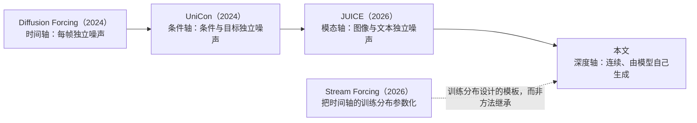
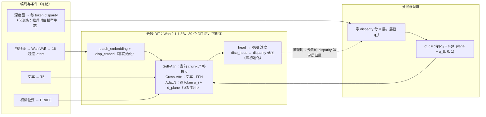
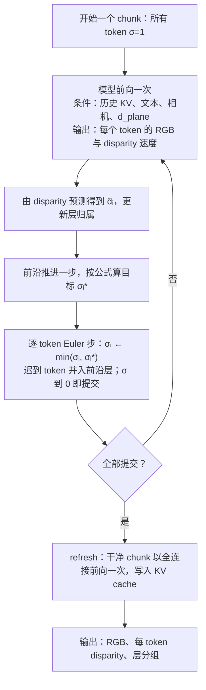

# WaveFront：先近后远去噪的世界模型

研究提案 v2 · 2026 年 10 月 23 日

> 标 **【待定·数据】** 的地方要先看 SpatialVID / OmniWorld-Game 的实际数据才能定，汇总在 6.4。

## 1. 概述

Diffusion 的调度一直是一维的：只有噪声水平 σ。我们在自回归视频 diffusion 的每个 chunk 内部加上第二个轴——深度——让每个 token 的噪声水平成为 (σ, 深度) 的函数。具体做法是把 chunk 内的 token 按 disparity 等距分成 K 层，用斜率 s 控制层与层之间的噪声错位：s=0 是标准 diffusion，s≥K 是严格的"先近后远"逐层自回归，二者之间是一个连续的滚动调度族。3D 一致性和分层深度表示由此成为调度的副产物，不需要渲染器、3D 教师特征或外部记忆。

对模型的改动：噪声水平从逐帧改为逐 token；新增一个标量条件 d_plane（当前扫描到哪个深度）；新增一个 disparity 输入/输出通道；当前 chunk 内的 attention 严格按噪声水平排序（噪声低的不看噪声高的）。新增参数全部零初始化，初始化时 s=0 的前向与原模型数值一致。一次训练覆盖整个调度族；核心实验是一张"路径表"：同一组权重，只换采样器走不同的调度路径，比较一致性、动态与质量（7.2）。

## 2. 背景与动机

AR 视频 diffusion（CausVid、Self-Forcing、Causal Forcing 及各类交互式世界模型）逐 chunk 生成，chunk 间 causal attention 加 KV cache，是实时世界模型的主流架构。它的核心弱点是没有 3D：相机转一圈回来场景变了，遮挡边界糊，长程不一致。

给视频 diffusion 补 3D 的方法有四类：联合输出几何通道或对齐几何特征（Aether、DeepVerse、Geometry Forcing）；3D 记忆检索（WorldMem、VMem、LSM-World、WorldKV）；3D 结构噪声（EquiVDM、UniCaMo、CameraNoise）；相机位置编码（PRoPE、SCoPE）。它们都在 backbone 外面挂东西，四个口子都已拥挤。它们从未动过的对象是**生成顺序本身**。本提案改的就是这个。

## 3. 核心想法

### 3.1 直觉

普通 diffusion 里"哪些地方先变清晰"是随机均匀的。我们让它由深度决定，像雾从近到远散开：第一轮只把离相机最近的一层去噪到底，其余仍是噪声；第二轮以近层为条件生成稍远一层；最后一轮是远景。

```
深度      近 ──────────────────────────────▶ 远
          第 0 层      第 1 层      第 2 层
第 1 轮   ████████     ░░░░░░░░     ░░░░░░░░
第 2 轮   ████████     ████████     ░░░░░░░░
第 3 轮   ████████     ████████     ████████

████ 已去噪到底，作为条件固定      ░░░░ 仍是噪声，等下一轮
```

### 3.2 为什么按 disparity 分层

Disparity = 1/深度。相机移动时一个物体在画面里的位移正比于 disparity（近树飞退、远山不动）。按 disparity 等距分层，意味着"同一层的东西在相机运动下位移量相近"，层编号本身有几何含义；跨帧条件时层与层能对上。

深度来自视频深度模型的伪标签。单目深度只有相对尺度，需要做 affine 归一化来保证层编号在时间上稳定；为了与推理时可用的信息一致，归一化参数只由第一个 chunk 决定（6.2）。

代价：户外画面大部分 token 的 disparity 接近 0，等距分层下层的大小可能很不均匀（远层很大、近层很小）。严重程度要看数据统计（6.3）**【待定·数据】**。

### 3.3 调度平面

把调度画在"去噪进度 × 深度层"的平面上，不同斜率是这个平面上的不同路径。下面以 K=3 层、每层 T=4 步为例，数字是每次模型调用之后该层所处的噪声档位（4 = 纯噪声，0 = 干净）：

```
s = 0：标准 diffusion，所有层同步，T 次调用
调用      1  2  3  4
第0层     3  2  1  0
第1层     3  2  1  0
第2层     3  2  1  0

0 < s < K：滚动扫描，相邻层错开（此例错开一档），T + (K-1) 次调用
调用      1  2  3  4  5  6
第0层     3  2  1  0  0  0
第1层     4  3  2  1  0  0
第2层     4  4  3  2  1  0

s >= K：严格逐层（深度自回归），K x T 次调用
调用      1  2  3  4  5  6  7  8  9 10 11 12
第0层     3  2  1  0  0  0  0  0  0  0  0  0
第1层     4  4  4  4  3  2  1  0  0  0  0  0
第2层     4  4  4  4  4  4  4  4  3  2  1  0
```

把斜率取负号就是远→近，表格上下翻转即可。

与已有"多轴噪声"工作的关系：



Diffusion Forcing 在时间轴上给每帧独立噪声；UniCon 用 timestep 解耦训练让成对输入各自带独立噪声调度，同一模型可以联合生成、条件生成，甚至用带噪条件做粗控制；JUICE 给图像流和文本流各自的噪声水平，把"谁是条件、谁先生成"交给采样器；Stream Forcing 把视频采样重写成按帧索引的噪声水平随机过程，在参数化空间里构造从"各帧独立"到"按时间递进"的连续训练轨迹。我们的轴与它们有一个本质区别：**深度是连续的、内生的**——每个 token 落在哪一层由模型自己生成的 disparity 决定，而模态、条件、帧索引都是外生的离散边界。调度按 K 层量化，K 在训练时随机、推理时可任选。代价是内容依赖的归属问题（4.4）。

## 4. 方法

### 4.1 基座与不动的部分

基座是 minWM 的 Wan 2.1 1.3B chunk-causal AR 模型。minWM 把训练分成四个 Stage：Stage 0 双向 SFT，Stage 1 用 teacher forcing 训练 causal AR 模型，Stage 2 做 ODE 或一致性蒸馏，Stage 3 做 DMD。我们从 Stage 1 的权重（带 PRoPE 相机条件）续训。teacher forcing 训练时，把整段视频的干净版本和带噪版本拼成一条序列：每个带噪 chunk 只能看到它之前的干净 chunk 和它自己，相当于用真值历史当上下文。

时间轴原样保留：一个 chunk 是 4 个 latent 帧，chunk 间 causal；每个 chunk 生成完后，再用干净结果前向一次，把它的 KV 写入 cache 供后续 chunk 使用（下称 refresh）。这些都不变——时间 causal 是 cache、蒸馏、流式的根基，真正缺的是 chunk 内的空间结构。位置编码不动（3D RoPE + PRoPE），顺序只由噪声水平和 attention mask 表达。

Token 网格：480×832 的视频经 VAE（空间 8×、时间 4×）再 patch 2×2，每个 latent 帧是 30×52 = 1560 个 token，每个 token 覆盖 16×16 像素；一个 chunk 有 6240 个 token。

### 4.2 分层与调度公式

**分层。** Disparity 归一化到 [0,1]（1 最近，0 无穷远）。chunk 内等距分成 K 层，第 ℓ 层（ℓ=0 最近）覆盖 (1−(ℓ+1)/K, 1−ℓ/K]（最后一层包含 0），层值取上沿 q_ℓ = 1 − ℓ/K。例如 K=4 时层值依次为 1、0.75、0.5、0.25。

**调度。** 同一层的 token 共用一个噪声水平：

$$\sigma_\ell=\operatorname{clip}\big(\sigma_0+s\,(d_{\text{plane}}-q_\ell),\;0,\;1\big)$$

每个 token 的 σ_i 就是它所在层的 σ_ℓ。噪声降到 0 的 token 称为**已提交**：此后它固定不变，作为其余 token 去噪的条件。式中 **d_plane 是前沿层的层值，σ_0 是前沿层当前的噪声**；前沿层指按扫描方向最先、尚未提交、且非空的那一层。s=0 时约定 d_plane=1。σ 经调度器换算成 Wan 的 timestep 送进 AdaLN。

为什么用层值 q_ℓ 而不是连续的 d_i：若把连续 d_i 代入，s→∞ 时每个 token 只能是 0 或 1，没有任何 token 经历中间噪声，"每层去噪 T 步"无从谈起。量化之后，只要 s ≥ K，相邻层的噪声至少差 1：前沿层取 σ_0，更近的截成 0，更远的截成 1——这就是严格逐层。因此**"斜率 ∞"定义为 s=K**，更大的 s 只会在层之间插入空转步，二者等价。

| 斜率 | 行为 | 每 chunk 模型调用数 |
|---|---|---|
| s = 0 | 所有层同步，标准 diffusion | T |
| 0 < s < K | 滚动：相邻层错开 s/K 的噪声 | T·(1 + s(K−1)/K) |
| s = K（"∞"） | 严格逐层：前沿层走完一轮再换下一层，更远的层保持纯噪声；空层跳过 | K·T（K 取非空层数） |

**参数化。** 公式里 σ_0 和 d_plane 只以 c = σ_0 + s·d_plane 的组合出现，一条推理路径就是 c 从 1+s 单调降到 s/K（s>0）。d_plane 和 σ_0 都由当前状态唯一确定，训练和推理喂给模型的条件是同一个状态函数。

**方向。** 远→近是斜率取负号，前沿层改为最远的未提交层；同一组权重，换采样器即可。近→远（ray marching）让未生成位置带 free-space 陈述、有 anytime 性质、与粗→细同向；远→近（画家算法）的优势是背景先定。这是真实分叉，必须消融。

### 4.3 disparity 通道

每个 token 在 RGB latent 旁带一个 disparity 标量，与颜色联合去噪，用同一个 σ_i。

- **来源**：伪深度降采样到 token 网格，取 token 覆盖像素上的高分位数（偏向近处），不走 VAE；见 6.2。
- **输入**：新增 `disp_embed: Linear(1→1536)`，加到 patch embedding 的输出上。
- **输出**：在输出头里，用同一份归一化加调制后的特征接 `disp_head: Linear(1536→1)`，预测 disparity 的速度。
- **初始化**：两者零初始化。在数学上等价于给 patch embedding 加一个输入通道、给输出头加一行，但不改变原有权重的形状。
- **尺度**：送进网络的是 d̃ = a·(2d − 1)。d 由 6.2 的因果归一化保证落在 [0,1]，先固定映射到 [−1,1]，再乘缩放 a。不用数据集统计量，换数据集不必重算；分层仍然用 [0,1] 的 d。
  - a 决定深度比颜色早多少成形。加噪是 x_σ = (1−σ)·x + σ·ε，信号放大 a 倍等价于这个通道的噪声变轻：以 [−1,1] 为基准，token 处在 σ 时，深度通道相当于处在 σ_eff，满足 (1−σ_eff)/σ_eff = a·(1−σ)/σ。例如 a=2、σ=0.5 时 σ_eff≈0.33。深度越早稳定，按深度分层的提交越可靠，可用的斜率范围越宽。
  - 用缩放而不是给深度单独一个 timestep：二者等价，但缩放保持"每个 token 一个 σ"，mask、提交规则和 d_plane 都依赖这一点。
  - a 不设为可学习：噪声在缩放之后加，loss 量级又随 a 变化，学出来的 a 会朝 loss 小的方向退化，而不是朝生成好的方向。
  - 默认 a=2，让深度略早于颜色成形。具体取值用短训扫 a ∈ {1, 2, 4} 确定，判据是 disparity 预测准确率随噪声水平的曲线（7.3）和 s=0 下的 RGB 质量，定下后写进 config 固定。a 过大时，深度会在几乎没有颜色信息时被定死，且 disparity 的 loss 按 a² 放大。
- **loss 权重**：每个 token 有 64 个 RGB 数值、1 个 disparity，用显式权重 λ 平衡，初值使两者每 token 的 loss 量级相当。a 会改变这一项的量级，所以先定 a 再调 λ。

### 4.4 token 归属与提交

训练时层归属由伪深度给出；推理时由模型当前预测的 disparity d̂_i 决定，每一步更新。推理时每一步：

1. 前沿推进一步（c 减 1/T），按 d̂_i 和 4.2 的公式算出每个 token 的目标噪声 σ_i\*。
2. **噪声只降不升**：σ_i ← min(σ_i, σ_i\*)。估计被改远的 token 暂停，等前沿追上来，不重新加噪。
3. **迟到 token 并入前沿层**：未提交 token 的噪声不低于前沿层。估计被改近的 token 跟着前沿层一起完成，而不是一步从高噪声直接提交（那相当于从噪声直接预测干净结果，质量差）。
4. σ 到 0 的 token 提交，之后以 σ=0 和固定值参与计算；最后一步强制全部提交。

训练用真值划层、推理用预测划层，这个 exposure bias 与 LLM 完全同构。训练后期把分层依据换成模型自己预测的 disparity（由一次无梯度前向得到），噪声仍按真值加，用来兜底。

### 4.5 条件 d_plane

d_plane 告诉模型"前沿在哪一层"：比它更近的内容已经固定，要生成的一切都在这个平面上或之后。σ 图只告诉模型每个 token 处在什么噪声，不告诉它当前层有多远——前景为空时，第 1 轮和第 3 轮的 σ 图完全一样。d_plane 走 timestep embedding 的路径：sinusoidal 编码后经零初始化的 Linear 加到 time embedding 上。斜率不单独喂，逐 token 噪声水平已经隐含了它。

### 4.6 Attention

**当前 chunk：严格按 σ。** query token i 能看 key token j，当且仅当 σ_j ≤ σ_i（噪声更低的不看噪声更高的）。同层的 token 互相可见；已提交（σ=0）的 token 之间互相可见；s=0 时所有 token σ 相同，退化为 chunk 内全连接，也就是原模型。mask 只由当前 σ 图决定，训练和推理用同一个函数生成。

**历史 chunk：不分层。** chunk 生成完后照原样做一次 refresh：把干净的整个 chunk 以 chunk 内全连接过一遍网络，把 KV 写进 cache。理由：

- 若历史 KV 在提交时按层写入，它的内容就取决于生成它时走的路径。换采样器会同时改变之后所有 chunk 的条件，"权重不变、只有路径在变"的论证就不干净了。
- teacher forcing 里干净的那一半与 Stage 1 训练时完全一样，没有分布漂移。
- 代价是每个 chunk 一次 refresh 前向，基线本来就要做。
- 3.2 所说的层的几何含义照样传得过去：历史 token 带着干净的 disparity 通道。

下图是严格逐层第 2 轮时的 mask。c1、c2 是历史 chunk，c3 是当前 chunk；N/M/F 分别是近、中、远层。c3 中 N 已提交（σ=0），M 正在去噪（σ=σ_0），F 仍是纯噪声（σ=1）。

```
               c1         c2         c3
key ->       N  M  F    N  M  F    N  M  F
c1 N         #  #  #    .  .  .    .  .  .
c1 M         #  #  #    .  .  .    .  .  .
c1 F         #  #  #    .  .  .    .  .  .
c2 N         #  #  #    #  #  #    .  .  .
c2 M         #  #  #    #  #  #    .  .  .
c2 F         #  #  #    #  #  #    .  .  .
c3 N         #  #  #    #  #  #    #  .  .
c3 M         #  #  #    #  #  #    #  #  .
c3 F         #  #  #    #  #  #    #  #  #

# 可见    . 屏蔽
```

**开关。** 当前 chunk 的 mask 可以切换成"chunk 内全连接"，噪声路径不变。这用来拆开"顺序影响 attention"和"顺序影响噪声路径"两条作用通道（7.2、第 11 节）。

### 4.7 训练分布

每个 chunk 独立采样一组调度参数。下面的比例是初值，按各斜率的 loss 再调。

1. **层数 K**：从 {2, 3, 4, 6, 8} 均匀采。
2. **路径类型**：

   | 类型 | 比例 | 说明 |
   |---|---|---|
   | s = 0 | 25% | 就是原模型的训练样本，保证不退化 |
   | 严格逐层 s = K | 25% | 路径表的严格端点 |
   | 中间斜率 0 < s < K | 35% | log-uniform |
   | 打乱层序 | 10% | 层仍按深度划分，但先后顺序随机排列；服务于"打乱层序"对照（7.2） |
   | 草稿-提交 | 5% | 已提交层为 0，其余所有 token 共用 σ_0；不在公式族内，只服务于路径表附加行 |

   s≠0 的各类型中，20% 取负号（远→近）。
3. **进度**：不直接均匀采 d_plane，而是先采"已提交 token 的比例" p。30% 概率 p=0（对应推理开头什么都没固定的状态），其余从 (0,1) 均匀采。取前 m 层为已提交，使其 token 比例最接近 p；第 m 层为前沿层。前沿层的 σ_0 在允许范围内按 Wan 常规 timestep 分布（shift=5）采：m=0 时范围是 (0,1]，否则是 (0, min(1, s/K)]，保证前 m 层恰好为 0。这样训练中"干净上下文的比例"与推理过程匹配，避开 Patch Forcing 指出的偏差：均匀采会让训练样本里几乎总有一大片干净 token，推理初期却什么都没有。
4. 由公式算出每层 σ，σ=0 的 token 给真值；loss 作用于全部 σ>0 token 的 RGB + λ·disparity。

### 4.8 退化检查

新增的投影（disp_embed、disp_head、d_plane 嵌入）全部零初始化。初始化时 s=0 的前向与原 Stage 1 模型在浮点误差内一致：这既是代码的单元测试，也是实验的基线。

### 4.9 结构总览



## 5. 算法流程

### 5.1 训练（每步一次前向）

1. 取一段视频的 VAE latent、每 token disparity、相机位姿（全部离线算好）。
2. 每个 chunk 按 4.7 采样 (K, 路径类型, s, p, σ_0)，按真值层归属算出逐 token σ_i 和 d_plane。
3. 按 σ_i 给 RGB latent 和 disparity 加噪（token 级 σ 上采样到它覆盖的 2×2 个 latent 像素）；σ=0 的 token 给真值。
4. 拼成 teacher forcing 的 [干净历史 | 带噪] 序列。干净一半的 mask 不变；带噪一半在 chunk 内按 4.6 严格按 σ，mask 按样本每步重建。
5. 以 d_plane、文本、相机为条件，flow-matching loss 作用于全部 σ>0 token 的 RGB + λ·disparity。

前向次数与原模型相同；额外开销是每步重建 mask，以及 token 级 AdaLN 多占的几 GB 显存。

### 5.2 推理（每个 chunk）



**采样器**：逐 token Euler，每个 token 用自己的步长 σ_i\* − σ_i。原 teacher forcing 推理用的 UniPC 是多步法，依赖所有 token 共用一张时间表，这里不适用。因此路径表的 s=0 行用同一个逐 token Euler，另报原 UniPC 作参考。

### 5.3 计算量

生成一个 chunk 要把去噪网络前向多少次，是 diffusion 采样成本的标准度量，文献里叫 NFE（number of function evaluations，函数求值次数）。原模型每个 chunk 走 T 步、每步前向一次，NFE 就是 T。分层之后层与层错开，总步数会变多：

N(s, K) = T·(1 + s(K−1)/K)，0 ≤ s ≤ K

以 T=50 为例：s=0 为 50 次；K=4、s=1 约 88 次；K=4 严格逐层为 200 次，是原模型的 4 倍。

这带来一个混淆：严格逐层如果效果更好，可能只是因为多算了几倍。所以 7.3 的第一个补充实验做"等 NFE 比较"：给所有路径同样的调用预算 N，各自反推每层步数 T = N / (1 + s(K−1)/K)。例如 N=200 时，s=0 走 200 步，K=4 严格逐层每层走 50 步。

## 6. 数据

### 6.1 数据集

方法只需视频 + 伪深度。相机位姿方法本身不用，但评测和 camera-conditioned 基座需要，所以直接用带标注的数据集。

- **SpatialVID**（CVPR 2026）：7,089 小时动态内容，逐帧相机位姿、深度图、动态 mask。主实验用 1,111 小时的 SpatialVID-HQ 子集中相机运动大的 50–100 小时。深度自带，先直接用；若层归属在时间上抖动，再用视频一致的深度模型（Video Depth Anything、π³ 类）重标。
- **OmniWorld-Game**（ICLR 2026）：游戏环境采集，真值深度和精确相机位姿，用于回答"伪深度噪声伤害多大"。

### 6.2 预处理（全部离线）

- **片段长度**：Wan VAE 把 F 个 latent 帧解码为 1+4(F−1) 个像素帧；chunk 固定为 4 个 latent 帧，所以 latent 帧数必须是 4 的倍数。
  - 快速验证用 45 个像素帧（12 个 latent 帧 = 3 个 chunk），后两个 chunk 有历史，能测到跨 chunk 的效果。
  - 完整训练用 77 个像素帧（20 个 latent 帧 = 5 个 chunk），与 minWM Stage 1 的 checkpoint、20 个 latent 帧的注意力窗口和推理配置一致。
  - 不改成 3 个 latent 帧一个 chunk 去凑 81 个像素帧：那会改变 checkpoint 已经学到的因果结构。
  - 一次训练内所有样本等长。分辨率 480×832；帧率对齐 minWM 现有 Wan 数据 **【待定·数据：SpatialVID 的原始帧率与采样方式】**。
- **VAE latent、T5 文本嵌入**：离线算好，训练循环不含 VAE 与 T5。
- **每 token disparity**：
  1. 深度 → disparity，归一化到 [0,1]（见下一条）。
  2. 一个 token 覆盖 16×16 像素；时间上第 0 个 latent 帧对应 1 个像素帧，之后每个对应 4 个。在这 16×16×1 或 16×16×4 个像素上取高分位数，初值 90% **【待定·数据：看遮挡边界上的归属】**。
  3. 存成 [F, 30, 52]。
- **归一化（保证因果）**：只用第一个 chunk 的统计量确定 affine 参数（例如把它的高分位映射到 0.9，给之后更近的物体留余量），后续 chunk 沿用并截断到 [0,1]。若 SpatialVID 的深度是度量深度，就改用固定映射 d = clip(z_ref / z, 0, 1)，完全不依赖视频统计量 **【待定·数据】**。
  - 不按整段视频归一化，原因有二：那样第 1 个 chunk 的标签会依赖之后 chunk 的内容（例如后面镜头推近一面墙），推理时无法复现；生成长视频时，"整段"也没有定义。
- **相机位姿**：转成 minWM 的格式——w2c、OpenCV 坐标系、`[tx,ty,tz,qx,qy,qz,qw]`、内参按图像尺寸归一化，每个 latent 帧一个位姿。约定弄错不会报错，只会让相机控制悄悄学歪；转换后用 `tools/data/wan21/check_dataset_bev.py` 把轨迹和视频画在一起检查。
- **存储**：沿用 minWM 的 LMDB 格式，新增 `disparity` 键。

### 6.3 层统计（训练前做）

在选出的 SpatialVID 子集上统计两件事：各 K 下每层的 token 占比；相邻 chunk 之间同一位置层号跳变的比例。若等距分层极不均衡（例如近层平均只占极小比例），就考虑改为按分位数分层，代价是失去 3.2 的几何含义。

### 6.4 待看数据决定的事项

| 事项 | 要看什么 | 影响 | 默认方案 |
|---|---|---|---|
| 深度类型 | SpatialVID 深度是度量还是相对；格式、分辨率 | 归一化方式 | 按相对深度处理：第一个 chunk 定 affine 参数 |
| 深度时间稳定性 | 逐帧闪烁程度 | 是否重标深度 | 先用自带深度 |
| 位姿约定 | c2w 或 w2c、OpenCV 或 OpenGL、内参 | 相机条件是否正确 | 转成 w2c OpenCV |
| 帧率与分辨率 | 原始帧率、宽高比 | 采样间隔、裁剪 | 对齐 minWM 现有 Wan 数据 |
| 选片 | 相机运动量的分布 | "运动大的 50–100 小时"的阈值 | 按平移量 + 旋转量排序取前段 |
| 层占比 | 6.3 的统计 | K 的取值范围；是否换分位数分层 | 等距，K ∈ {2, 3, 4, 6, 8} |
| token 聚合分位数 | 遮挡边界上的归属 | 层归属是否稳健 | 90% |
| OmniWorld-Game | 深度与位姿格式 | 真/伪深度对照能否直接做 | 同一套预处理 |

## 7. 评测与实验设计

### 7.1 三层评测

- **通用质量保底**：VBench、FVD。dynamic degree 必须与一致性指标同表——多个 benchmark 已指出空间一致性强的模型倾向于把场景做静态。
- **空间一致性（核心主张）**：WorldScore 作基础分；重访类选 R2M-Bench（out-and-back、平移-旋转、闭环三种返回轨迹，相对评分）或 WBench（多轮，gated 空间一致性惩罚"靠不动刷分"）作主表；MIND、LoopNav、WorldMemBench 放附录。
- **只有本方法能做的**：生成的 disparity 与外部深度估计器在生成帧上的结果做自洽比较；按层单应变换 warp 到小幅相机运动的新视角，与模型自己生成的对应帧比重投影误差；K 扫描曲线。

### 7.2 核心实验：路径表

同一组权重，只换采样器。因为训练覆盖整个调度族（4.7），这张表只需一次训练；而且论证最干净：权重不变，只有路径在变。

| 行 | 路径 | 回答什么 |
|---|---|---|
| s=0，逐 token Euler | 原模型路径，同一采样器 | 基线；也是"同等深度监督、无顺序"的对照 |
| s=0，原 UniPC | 原推理方式 | 采样器本身的影响 |
| 严格近→远，K ∈ {2, 4, 8} | s = K | 纯深度顺序 |
| 严格远→近 | s = −K | 方向 |
| 中间斜率 ×3–4 | 0 < s < K | 连续调度族 |
| 打乱层序 | 按深度分层，但先后随机 | 深度顺序本身是否重要 |
| 难度优先 | 按难度分组排序 **【难度 proxy 与对应的训练分支待定】** | 物理深度 vs 通用难度 |
| 草稿-提交 | 每轮生成全部剩余 token，只保留前沿层 | 用干净的深度估计决定归属是否更好 |
| mask 开关 | 上述关键路径 × chunk 内全连接 | 拆开 attention 与噪声路径两条作用通道 |

列：一致性、动态、质量、每 chunk 调用数。

### 7.3 三个补充实验，各回答一个问题

1. **收益是不是多算出来的**：等 NFE 比较。固定每 chunk 总调用数，按 5.3 的公式反推 T，扫 (s, K) 的组合，画质量曲线。预期曲线非单调，最优点在中间。
2. **3D 到底在哪**：沿用 Geometry Forcing 的探针协议（冻结 backbone，中间层特征上训 DPT 头预测几何，目标来自 VGGT），做两处修改以避免 confound。一是对照组是"同一权重、s=0 推理"；二是探我们没监督过的量：世界坐标系 pointmap、chunk 间相对相机位姿、给定相机运动下下一 chunk 的深度。另加两条独有的分析轴：按 DiT 层索引、按扫描位置画几何质量曲线。
3. **这个平面哪里可走**：disparity 预测准确率随噪声水平的曲线。深度在去噪中稳定得越早，可用的斜率范围越宽。在快速验证的短训里顺手测，也用来定 disparity 的缩放 a（4.3）。

## 8. 实施计划

### 8.1 代码库

**minWM**（shengshu-ai，2026.5）。四个 Stage 齐全（双向 + 相机 SFT → causal teacher-forcing AR → causal CD → causal DMD），带相机位姿数据处理成 latent 的流程、LMDB latent 数据集、每个 Stage 的 checkpoint、序列并行和踩坑记录。基座选 Wan 2.1 1.3B 这条线（HY 1.5 为 8B，超出算力预算）。备选 Causal Forcing 官方仓库（支持 Rolling Forcing）。不选 Self-Forcing：训练无数据、无相机控制，重访类 benchmark 跑不了。

### 8.2 代码改动

| 改动 | 位置 |
|---|---|
| 逐 token 噪声：加噪、loss 权重支持 token 级 σ | `minwm/sampling/schedulers.py`；新 preprocessor 替代 `FlowNoise`（`minwm/processors/`） |
| token 级 AdaLN：block 已支持，改序列并行分支里的展开 | `minwm/modeling/wan21/causal.py`（SP 分支） |
| d_plane 嵌入（零初始化） | `causal.py`，time embedding 之后 |
| disp_embed / disp_head（零初始化，加进 `init_weights` 的置零列表） | `causal.py`（含 `CausalHead`） |
| teacher forcing mask：带噪一半 chunk 内严格按 σ，按样本每步重建 | `causal.py` 的 `_prepare_teacher_forcing_mask` 及 `block_mask` 缓存 |
| 推理 attention 支持 chunk 内 mask（改用 flex attention） | `minwm/modeling/wan21/blocks.py`（推理分支） |
| 逐 token Euler 采样器 + 前沿与提交逻辑 | `minwm/engine/inference/` |
| loss：RGB + λ·disparity，只算 σ>0 | `minwm/engine/training/losses.py` |
| 数据集：新增 `disparity` 键 | `minwm/data/datasets/lmdb.py` 子类；预处理脚本参照 `tools/data/wan21/build_worldplaygen_lmdb.py` |
| 配置与冒烟测试：Wan 版 mock config | `configs/wan21/`（参照 `configs/hy/_model_mock.py`） |
| 单元测试：s=0 等价、mask 正确性 | `tests/` |

**Checkpoint 加载**：Stage 1 checkpoint 里没有新增的参数，严格加载会报缺键。写一个一次性脚本，给 checkpoint 补上全零的新参数（checkpoint 手术），保持严格加载——这样参数名拼错时仍会报错。

**推理的第一版实现**：每步把整个 chunk（已提交 token 以 σ=0 带着）重算一遍，mask 由当前 σ 图决定；结果正确，但不省计算。加速放到后面：提交集合不变期间，已提交 token 的 KV 不变，只需在每次有 token 提交时重算一次。

### 8.3 阶段与算力

下表的"阶段"是本项目的实施阶段，与 4.1 介绍的 minWM Stage 编号无关。

| 阶段 | 内容 | 8×A100 80GB 估时 |
|---|---|---|
| 准备 | Wan mock config 跑通训练与推理；s=0 等价测试；6.3 层统计；6.4 各项定案 | 1–2 天 |
| 0 假设验证 | 快速验证：从 minWM Stage 1 AR + 相机 checkpoint 续训，480p、45 个像素帧（3 个 chunk）、3–5K 训练步、batch 16；同时测 disparity-vs-噪声曲线，并扫 a ∈ {1, 2, 4}；跑简版路径表 | 2–3 天 |
| 1 完整续训 | 77 个像素帧（5 个 chunk），同配置延长；后期换成按模型预测的 disparity 分层（4.4） | 3–4 天 |
| 2 路径表与分析 | 完整路径表、等 NFE、真/伪深度对照、probing | 约 1 周（推理为主） |
| 3 评测 | 三层 benchmark | 2–3 天 |
| 4 蒸馏（可选） | minWM Stage 2/3；DMD 只作用于 RGB 通道，深度通道由阶段 1 模型自蒸馏 | 1–2 天 |

路径表不需要多次训练，全程约两到三周。最低配置：核心阶段 1 张卡即可，DMD 至少 2 张；建议 2–4 张保证迭代速度。阶段 0 的结论决定继续还是转向 10.3。

## 9. 风险与应对

| 风险 | 应对 |
|---|---|
| patch 跨越遮挡边界 | 高分位数（偏向近处）归属 + 迟到 token 并入前沿层；最可能出 artifact 的地方，优先观察 |
| 伪深度逐帧闪烁导致层归属抖动 | 视频一致深度模型 + 因果归一化；OmniWorld-Game 真深度作对照 |
| 训练用真值划层、推理用预测划层的偏差累积 | 噪声只降不升 + 迟到并入；阶段 1 后期按预测 disparity 分层训练 |
| 等距分层的层大小极不均衡 | 6.3 统计；必要时改分位数分层 |
| 训练覆盖整个调度族，导致每条路径的样本变稀 | 端点（s=0、s=K）各 25% 点质量；观察各斜率下的 loss |
| 深度在去噪后期才稳定，可用斜率范围窄 | 用缩放 a 让深度先于颜色成形；阶段 0 的曲线提前判断；退回陡斜率 + 蒸馏 |
| 严格逐层的调用数是 K 倍 | 等 NFE 比较；复用已提交 token 的 KV；蒸馏 |
| 每步按样本重建 mask 的开销 | 实测；过大时按层重排 token，换取块稀疏 |
| 一致性涨、动态掉 | 动态指标与一致性同表；WBench gated 指标 |
| 假设本身不成立 | 阶段 0 最小代价证伪；转向 10.3 |

## 10. 可选扩展

**10.1 自适应斜率与 K。** 采样器按 token 深度估计的稳定程度决定何时提交，像 ODE 求解器的自适应步长；场景简单时自动接近斜率 0。

**10.2 蒸馏。** 让 K 变大时成本不难看，并附带实时性。排在最后。

**10.3 备选方案：等变约束。** 若深度调度被证伪，转向对 KV cache 施加 SE(3) 等变约束、不用深度监督让 3D 涌现。祖先是 Equivariant Neural Rendering（ICML 2020），现代 AR diffusion 中无人做过。

## 11. 相关工作

我们的方法同时触及三个问题：生成顺序由谁决定，几何如何进入生成过程，顺序如何影响自回归视频的计算与一致性。已有工作在每个问题上都有紧密的先例；本文的位置是三者的一个特定交点。

**谁决定空间生成顺序。** 视觉自回归模型的顺序经历了从固定到学习的演变：raster 顺序（VQGAN、LlamaGen）、next-scale（VAR）、VideoAR 把预测单元当作设计轴；MAR、RandAR 用随机顺序，masked diffusion 可视为学习顺序的 AR，MaskGIT 按置信度决定先后。与此平行的是逐 token 噪声水平的路线：Diffusion Forcing 的一般形式本就是每个 token 独立的噪声水平，论文主要用于时间序列；Patch Forcing 把它落到图像 patch 上，加一个难度头让容易区域先完成、作为困难区域的上下文，并指出朴素的 patch 级独立采样会产生推理时不存在的过度知情训练状态；AsyncPatch Diffusion 让同一模型支持同步、空间自回归、修补等多条空间噪声路径；RAD 在修补任务里用逐像素噪声调度和空间噪声嵌入；MuLAN 学习依赖数据的多变量噪声调度；Spatial Reasoning Models 由去噪网络自己预测生成顺序；PONDER 学习下一步生成的位置并允许撤销。因此，"逐 token 噪声、同步与自回归之间连续过渡、内容依赖且由模型自己决定的顺序"都不是本文的新意。本文的区别在于**顺序的键**：不是难度、置信度或学习到的偏好，而是一个物理量——视线上的可见深度——它由模型与 RGB 联合预测、随生成过程更新，并用于 chunk-causal 视频 diffusion 的 chunk 内部。本文要回答的问题相应地是：对视频生成而言，物理深度是否比通用难度更适合作为顺序先验，并带来超出联合深度监督的几何一致性。这直接对应路径表中"难度优先"和"打乱层序"两行（7.2）。

**几何如何进入生成。** 已有四条桥。其一是联合输出：Aether 联合去噪 RGB、深度与相机动作并用零初始化扩展通道，DeepVerse 把 RGB、disparity 与射线图组成联合预测状态并喂回下一步，Modality Forcing 让 RGB latent 与像素空间深度各带独立噪声、一个 checkpoint 支持联合与双向条件生成。其二是特征对齐：Geometry Forcing 把 backbone 内部表示对齐到 VGGT 的几何特征。其三是深度引导采样：DAG 从扩散中间表示预测深度并以深度一致性指导采样。其四是沿射线的分层表示：X-Ray 把沿相机射线排列的多层表面编码成类视频序列生成；World Tracing 为每个像素生成从可见表面到遮挡表面的有序点栈，并对可见层与遮挡层使用不同的噪声调度；更早的 LDI 与 MPI 是其图形学源头。此外 Channel-wise Noise Scheduled Diffusion 用不同通道的调度表达几何、材质、光照之间的生成依赖，Latent Forcing 让 latent 先于像素形成，说明"用调度让有用结构先出现"已有一般先例。本文与这些工作的区别是几何的角色：深度在本文中既是联合输出，更是**调度的键**——它决定同一帧内 RGB token 被解析的先后与依赖，而不是作为额外的重建目标或特征目标。与 World Tracing 的区别需要明说：它的"层"是同一条射线上的第几个交点，一个像素带多个表面；本文的"层"是不同像素按可见深度划分的区间，每个像素只有一个可见表面，因此本文提供的是视角相关的 2.5D 顺序先验，不保存被遮挡的内容，也不等价于 LDI 或 MPI。

**顺序如何影响自回归视频的计算与一致性。** chunk-causal 的 AR 视频 diffusion（CausVid、Self Forcing、Causal Forcing、Rolling Forcing、minWM）在 chunk 之间做 causal、在 chunk 内同步去噪，Rolling Forcing 进一步在时间轴上使用阶梯式噪声。token 级的提前提交与 KV 复用近期也已出现：ForcingBooster 让 AR 视频里的 patch 提前终止，保留其干净估计与 KV，并用 rollout 训练轻量路由器决定何时停；Speculative Forcing 按收敛程度接受中间草稿、冻结输出与 KV，只继续更新未完成区域。本文复用同一套"提交—缓存"机制，但两点不同：提交的顺序由预测深度而非收敛度或难度驱动；目标是遮挡与跨视角一致性而非自适应计算。另外 DepthArb 在图像合成中按深度顺序调制遮挡区域的 attention，这提示"顺序影响 attention"和"顺序影响噪声路径"是两条可以分开的作用通道——本文同时改动了两者，路径表用 mask 开关把它们拆开（7.2）。

**正交的 3D 补法。** 3D 记忆（WorldMem、VMem、LSM-World、WorldKV、RELIC）、3D 结构噪声（EquiVDM、UniCaMo、CameraNoise）和相机位置编码（PRoPE、SCoPE）从检索、噪声分布和位置编码三个方向补几何，不改变生成顺序。它们与本文正交，可以叠加；本文基座自带 PRoPE，记忆类方法可作为后续扩展。

**定位。** 在保留 chunk-causal 结构的前提下，本文以模型联合预测的场景深度参数化 chunk 内的空间去噪路径，并通过等几何监督、等计算预算的对照，检验与可见性相关的生成顺序能否改善遮挡与跨视角一致性。贡献由三部分构成：一个闭合的、由预测深度驱动的调度—提交—缓存算法；一组排除深度监督与额外计算混淆的因果对照；以及解释该顺序何时有效、何时失败的几何机制分析。

## 附：相对 v1 的改动

1. **调度公式**：用层值 q_ℓ 代替连续的 d_i；"斜率 ∞"定义为 s=K（严格逐层）；d_plane、σ_0 明确为前沿层的状态量。这消除了两处问题：v1 中连续 d 在 s→∞ 时只有 0/1 两档；v1 的 d_plane 表格"生成全部、保留一层"与公式不一致。后者保留为路径表的附加行"草稿-提交"。
2. **Attention**：当前 chunk 内严格按 σ；历史 chunk 保留全连接 refresh（v1 图中历史 chunk 也按层 causal）；新增 mask 开关。
3. **分层理由**：新增 3.2（为什么按 disparity 分层）；归一化改为因果，只用第一个 chunk 的统计量。
4. **disparity 通道**：用独立的零初始化模块实现；输入固定映射到 [−1,1] 再乘超参数 a（不用数据集统计量）；loss 显式加权 λ。
5. **训练分布**：按已提交比例采样（吸收 v1 的修改意见），并加入"打乱层序""草稿-提交"两个小分支。
6. **提交规则**：迟到 token 并入前沿层，不再一步提交；噪声只降不升。
7. **推理**：采样器改为逐 token Euler；推理 attention 需支持 mask。
8. **帧数**：33/81 → 45/77（chunk 为 4 个 latent 帧，要求 latent 帧数是 4 的倍数）。
9. **图**：改为文本图与 Mermaid。
